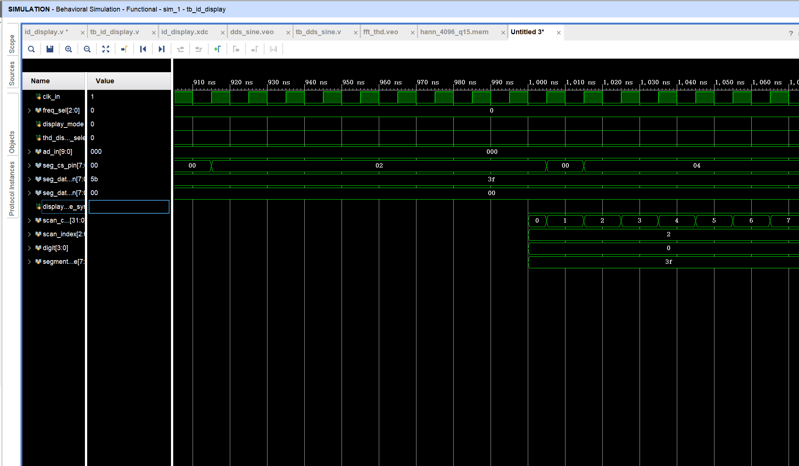
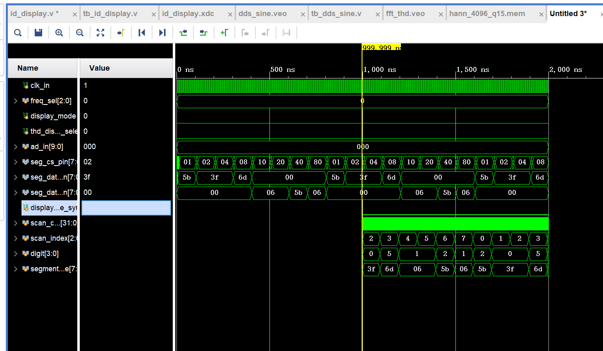
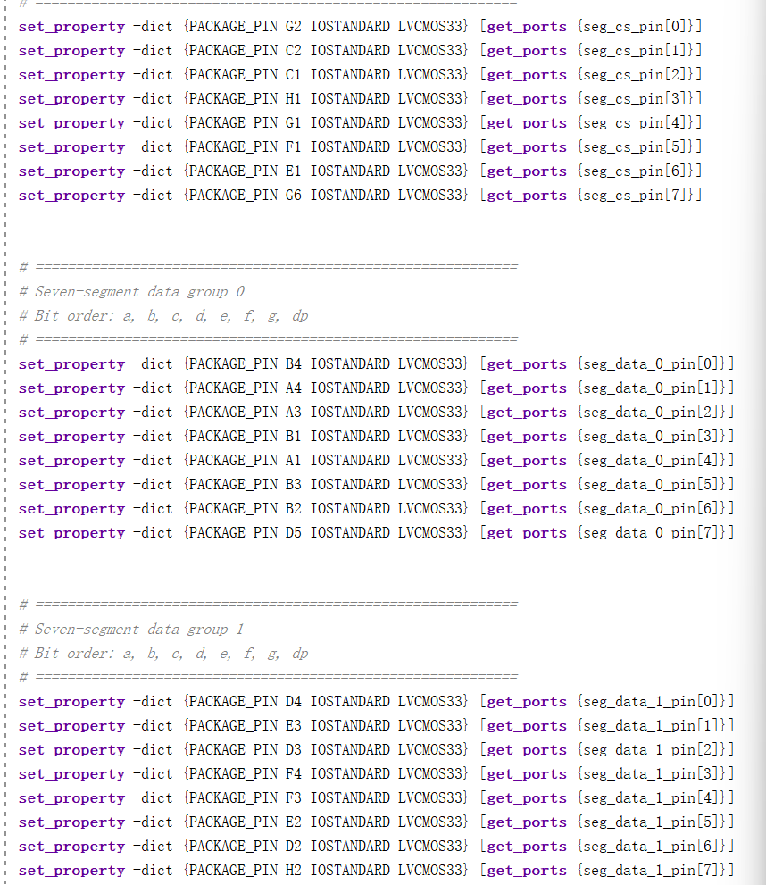
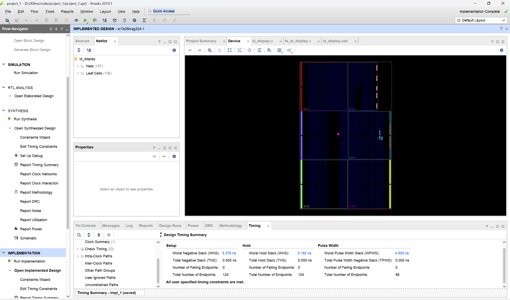
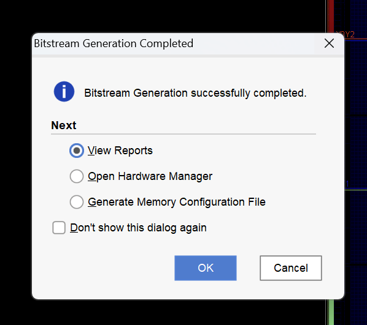
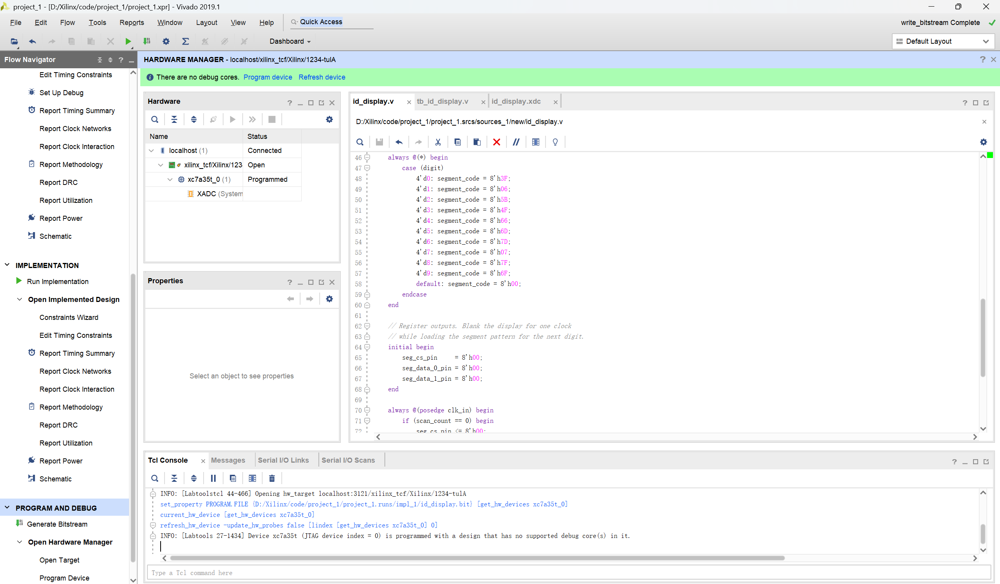
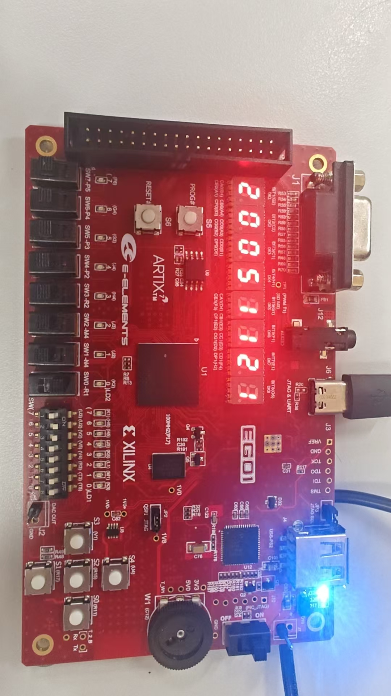

# 任务一学习日志：八位数码管动态显示ID

> 学习日期：2026-10-22  
> 显示内容：`20051121`  
> 当前定位：已完成工程的复盘学习与材料归档  
> 对应报告：[任务一设计分析报告](../../reports/task1/任务一_ID显示_设计分析报告.md)

## 0. 先明确任务边界

本次复盘的正式任务是：使用FPGA驱动八位七段数码管，动态显示ID `20051121`。

对话后面完成的单频率正弦信号产生属于任务二的预备实验，不应与任务一混在一起。任务一只负责建立可复用的显示能力：扫描八个位置、选择数字、译码段码、输出位选和段选。后续测频和THD任务仍会复用这套显示结构，只是八个数字不再固定为ID，而是来自测量结果。

## 1. 任务地图

```text
任务目标：八位数码管显示20051121
    ↓
输入：100 MHz板载时钟clk_in
    ↓
核心处理：扫描计数 → 位置选择 → 数字选择 → 段码译码
    ↓
输出：seg_cs_pin + seg_data_0_pin + seg_data_1_pin
    ↓
验证：行为仿真 → 综合 → 实现 → 比特流 → JTAG下载 → 上板照片
```

任务一的关键不是“同时控制八位”，而是让八位数码管快速轮流点亮。任一瞬间通常只有一位被选中，但扫描足够快时，人眼会把它们看成同时稳定显示。

## 2. 我最容易混乱的基础：时钟、周期和频率

### 2.1 时钟不是单独的“频率”或“时间”

时钟是一种周期性变化的数字信号。它同时具有：

- **频率**：每秒重复多少次，单位Hz；
- **周期**：重复一次花多长时间，单位s、ms、μs或ns；
- **时钟沿**：从0变1的上升沿或从1变0的下降沿。

频率与周期互为倒数：

\[
T=\frac{1}{f},\qquad f=\frac{1}{T}
\]

本工程时钟为100 MHz：

\[
100\ \text{MHz}=100\,000\,000\ \text{Hz}
\]

因此：

\[
T_{clk}=\frac{1}{100\,000\,000\ \text{Hz}}=10\ \text{ns}
\]

准确说法是：相邻两个上升沿之间相差一个时钟周期，即10 ns。口语中的“过去一个时钟”，通常指从一个有效沿到下一个同类型有效沿。

### 2.2 单位换算

```text
1 s  = 1 000 ms
1 ms = 1 000 μs
1 μs = 1 000 ns

1 MHz = 1 000 000 Hz
1 kHz = 1 000 Hz
```

任务一常用的换算：

```text
50 000个时钟 × 10 ns/时钟
= 500 000 ns
= 500 μs
= 0.5 ms
```

## 3. `SCAN_CYCLES=50_000`是不是“计数50000次”

是。最终工程的扫描参数为：

```verilog
parameter integer SCAN_CYCLES = 50_000;
```

核心计数逻辑为：

```verilog
always @(posedge clk_in) begin
    if (scan_count == SCAN_CYCLES - 1) begin
        scan_count <= 32'd0;
        scan_index <= scan_index + 3'd1;
    end else begin
        scan_count <= scan_count + 32'd1;
    end
end
```

每来一个100 MHz时钟上升沿，`scan_count`加1。它依次经历0～49 999，共50 000个时钟周期，然后清零并让 `scan_index`切换到下一位。

因此：

\[
T_{digit}=50\,000\times10\ \text{ns}=0.5\ \text{ms}
\]

八位完成一轮：

\[
T_{frame}=8\times0.5\ \text{ms}=4\ \text{ms}
\]

理论刷新率：

\[
f_{frame}=\frac{1}{4\ \text{ms}}=250\ \text{Hz}
\]

这里的250 Hz是代码参数计算得到的理论值，并非示波器实测值。

## 4. `scan_index`究竟表示什么

`scan_index`是三位寄存器，可以表示0～7：

```verilog
reg [2:0] scan_index = 3'd0;
```

它表示当前扫描的**位置编号**，不是要显示的数字。位置编号与数字内容通过 `case`建立映射：

| `scan_index` | `digit` | ID中的内容 |
|---:|---:|---:|
| 0 | 2 | 第1个字符2 |
| 1 | 0 | 第2个字符0 |
| 2 | 0 | 第3个字符0 |
| 3 | 5 | 第4个字符5 |
| 4 | 1 | 第5个字符1 |
| 5 | 1 | 第6个字符1 |
| 6 | 2 | 第7个字符2 |
| 7 | 1 | 第8个字符1 |

代码编号从0开始，所以 `scan_index=2`是人们日常所说的“第三位”，不是第二位。

## 5. `digit`、`segment_code`、段数据组和位选的关系

这是任务一最关键、也最容易混淆的部分。

### 5.1 四个量分别负责什么

1. `scan_index`：当前处理八个位置中的哪一个；
2. `digit`：这个位置要显示哪个十进制数字；
3. `segment_code`：为了画出这个数字，a～g哪些段要点亮；
4. `seg_cs_pin`：最终打开八位数码管中的具体哪一位。

两组段数据：

- `seg_data_0_pin`把段码送到第0～3位所在的一组段线；
- `seg_data_1_pin`把段码送到第4～7位所在的一组段线。

所以它们的工作顺序是：

```text
scan_index确定位置
    ↓
digit确定该位置的数字
    ↓
segment_code确定数字的笔画
    ↓
seg_data_0/1选择前四位或后四位这组段线
    ↓
seg_cs_pin在该组中选中准确的一位
```

段数据组并不能单独确定具体数码管，它只负责把“显示什么形状”送到相应的半组；真正确定八位中的具体位置仍依靠独热位选 `seg_cs_pin`。

### 5.2 `segment_code`不是“第几位”

`segment_code`表示七段字形。例如：

```verilog
4'd0: segment_code = 8'h3F;
4'd1: segment_code = 8'h06;
4'd2: segment_code = 8'h5B;
4'd5: segment_code = 8'h6D;
```

段码位序为：

```text
{dp, g, f, e, d, c, b, a}
```

数字2点亮 `a、b、d、e、g`：

```text
二进制：0101_1011
十六进制：5B
Verilog：8'h5B
```

`8'h5B`中的：

- `8`：常量总位宽是8位；
- `'h`：后面的数按十六进制书写；
- `5B`：十六进制数值。

因此 `8'h5B`与 `8'b0101_1011`表示同一个8位数。

### 5.3 为什么声明成`reg`却不一定是寄存器

`segment_code`由下面的组合逻辑产生：

```verilog
always @(*) begin
    case (digit)
        ...
    endcase
end
```

Verilog中，在 `always`块内被赋值的信号需要声明为 `reg`类型，但是否形成物理触发器取决于描述方式。`always @(*)`且所有分支均赋值时，综合结果是组合译码逻辑，不是时钟寄存器。

## 6. `8'b0000_0001 << scan_index`是什么意思

`<<`是逻辑左移运算符：

```verilog
seg_cs_pin <= 8'b0000_0001 << scan_index;
```

从最低位的1开始，按照 `scan_index`向左移动：

| `scan_index` | 二进制结果 | 十六进制显示 |
|---:|---|---|
| 0 | `0000_0001` | `01` |
| 1 | `0000_0010` | `02` |
| 2 | `0000_0100` | `04` |
| 3 | `0000_1000` | `08` |
| 4 | `0001_0000` | `10` |
| 5 | `0010_0000` | `20` |
| 6 | `0100_0000` | `40` |
| 7 | `1000_0000` | `80` |

任意时刻只有一个比特为1，因此称为独热码。

此前讲解中出现过：

```verilog
8'b0000_0001 << 5
```

这只是把 `scan_index=5`代入后的推演示例，所以在源文件里找不到完全相同的一行。真实源代码始终是：

```verilog
8'b0000_0001 << scan_index
```

## 7. 为什么切换数码管时要先全灭

如果位选和段码在切换瞬间不同步，下一位可能短暂显示上一位的段码，形成重影。代码用一个短暂消隐过程避免这个问题：

```text
保持旧位显示
    ↓
seg_cs_pin = 00，关闭全部数码管
    ↓
更新下一位对应的段数据
    ↓
打开新的独热位选
```

实际仿真捕捉到了：

```text
02 → 00 → 04
```



这表示从位选 `02`切换到 `04`之前，先出现一个时钟周期的 `00`全灭状态。

## 8. 非阻塞赋值：为什么波形里计数已经是1，位选却仍然为00

时序逻辑中的非阻塞赋值 `<=`遵循：

> 同一个时钟沿进行判断时使用旧值；该时钟沿的所有判断完成后，寄存器一起更新为新值。

以消隐时刻为例：

| 时刻 | 时钟沿前旧值 | 本次判断 | 时钟沿后新值 |
|---|---|---|---|
| A | `scan_count=0` | 条件成立，要求位选清零；计数器要求加1 | `scan_count=1`，`seg_cs_pin=00` |
| B | `scan_count=1` | 消隐条件不成立，要求打开当前位置 | `scan_count=2`，位选成为独热码 |

因此在时钟沿A之后看到“计数器为1、位选为00”完全正确。位选清零的决定，是根据时钟沿前的旧值0作出的。

## 9. Testbench为什么把50 000改成10

真实硬件使用50 000个时钟保持一位。如果仿真也使用该参数，观察完整八位扫描需要4 ms，对数字逻辑验证没有必要。

Testbench使用参数覆盖：

```verilog
id_display #(
    .SCAN_CYCLES(10)
) dut (...);
```

此时：

```text
一位：10 × 10 ns = 100 ns
八位一轮：8 × 100 ns = 800 ns
仿真2 μs：约能看到2.5轮
```

这只加快仿真，不会改变数字顺序、段码、独热位选和消隐逻辑。

最终集成顶层增加了后续任务的输入端口，因此复测任务一时还需要固定：

```verilog
reg [2:0] freq_sel = 3'b000;
reg       display_mode = 1'b0;
reg       thd_display_select = 1'b0;
reg [9:0] ad_in = 10'd0;
```

其中 `display_mode=0`用于选择ID显示分支，其余输入固定为0，避免无关输入处于未知状态。

## 10. 仿真波形应该按什么顺序看

不要先盯着最终段码猜数字，应按照控制顺序逐层检查：

1. `clk_in`是否为10 ns周期；
2. `scan_count`是否循环计数；
3. `scan_index`是否按0～7变化；
4. `digit`是否依次为2、0、0、5、1、1、2、1；
5. `segment_code`是否对应5B、3F、3F、6D、06、06、5B、06；
6. `seg_cs_pin`是否依次为01、02、04、08、10、20、40、80；
7. 段码是否送到正确的 `seg_data_0_pin`或 `seg_data_1_pin`；
8. 换位时是否出现短暂的 `seg_cs_pin=00`。



相邻位置显示相同数字时，例如两个连续的0，`segment_code`都为3F，所以段数据波形可能连成一段，看起来没有变化；此时应查看 `seg_cs_pin`，它仍会从02切换到04，表示显示位置已经变化。

## 11. XDC与24根数码管相关引脚

数码管相关约束共包含：

```text
8根seg_cs_pin位选
+ 8根seg_data_0_pin段线
+ 8根seg_data_1_pin段线
= 24根FPGA引脚
```



例如：

```tcl
set_property -dict {PACKAGE_PIN G2 IOSTANDARD LVCMOS33} \
    [get_ports {seg_cs_pin[0]}]
```

- `get_ports`找到顶层Verilog端口；
- `PACKAGE_PIN G2`把端口连接到FPGA的G2物理管脚；
- `IOSTANDARD LVCMOS33`指定3.3 V LVCMOS电平标准。

Verilog说明“逻辑怎样工作”，XDC说明“逻辑端口接到板上的哪里”。

## 12. 从代码到上板的完整流程

### 12.1 行为仿真

只验证逻辑和时序关系，不经过真实FPGA管脚。任务一波形已经证明数字顺序、段码、位选和消隐正确。

### 12.2 综合 Synthesis

把Verilog硬件描述转换成网表：

```text
scan_count → 一组寄存器和加法器
到值判断 → 比较器
case译码 → LUT组合逻辑
scan_index → 三位寄存器
```

综合成功只表示代码能够转换成硬件结构，不等于上板功能已经正确。

### 12.3 实现 Implementation

将网表中的逻辑单元放入FPGA具体位置并完成内部布线，然后按照10 ns时钟约束检查路径延迟。



任务一截图中WNS为5.376 ns、TNS为0、失败端点为0，说明相应版本满足设置的时序约束。

### 12.4 生成比特流

把最终的逻辑、布局、布线、I/O和时钟配置编码成 `.bit`文件。



### 12.5 JTAG下载

```text
电脑中的.bit文件
    ↓ USB
板载USB转换电路
    ↓ JTAG
FPGA配置存储单元
```

JTAG和USB-UART可以共用开发板上的同一个物理USB接口，但它们是两种不同的逻辑功能：JTAG用于配置和调试FPGA，UART用于串行收发数据。任务一只使用JTAG。



### 12.6 上板验证



实拍中显示 `20051121`，证明扫描逻辑、段码、位选、XDC管脚和下载链路在真实硬件上共同工作。照片不能直接证明刷新率为250 Hz；250 Hz仍属于理论计算结果。

## 13. 以后混乱时直接复述这段话

> 100 MHz时钟表示相邻两个上升沿之间是10 ns。每来一个上升沿，`scan_count`加1；累计50 000个时钟就是0.5 ms，然后 `scan_index`切换到下一位。`scan_index`先确定八个位置中的哪一位，`digit`确定这一位显示什么数字，`segment_code`把数字变成a～g段的点亮组合。`seg_data_0_pin`和`seg_data_1_pin`把段码送到前四位或后四位所在的段线组，`seg_cs_pin`用独热码打开具体的一位。换位时先全部关闭一个时钟，再加载新段码并打开下一位。八位扫描一轮需要4 ms，所以理论刷新率是250 Hz，人眼看到稳定的 `20051121`。

## 14. 证据应该怎样表述

| 结论 | 依据 | 应使用的表述 |
|---|---|---|
| 100 MHz对应10 ns | 时钟约束与公式 | 理论计算 |
| 单位扫描0.5 ms | `SCAN_CYCLES=50_000` | 理论计算 |
| 整屏刷新250 Hz | 八位扫描时间 | 理论计算，未用示波器实测 |
| 位选按独热码循环 | 行为仿真波形 | 仿真结果 |
| 换位存在全灭阶段 | 局部仿真波形 | 仿真结果 |
| 实现满足时序 | Vivado Timing Summary | 工具实现结果 |
| 显示20051121 | 开发板照片 | 上板实测结果 |

## 15. 本次真实问题与解决方法

1. **最终顶层端口比原任务一更多**：给后续任务输入提供稳定值，并用 `display_mode=0`选择ID模式。
2. **硬件扫描参数使仿真太慢**：Testbench用 `.SCAN_CYCLES(10)`缩短仿真时间。
3. **仿真日志被其他进程占用**：关闭原有仿真会话后重新启动行为仿真。
4. **把数值代入示例误认为源代码**：明确真实代码使用变量 `scan_index`，带数字5的表达式只是推演。

## 16. AI使用与更正

AI参与了原理解释、代码与硬件对应、波形解读、材料归档和报告整理。

发生过两项需要记录的更正：

1. AI曾因看到工作区中的任务二备份而误判当前范围；用户纠正后，重新把任务一ID显示作为独立主线。
2. AI讲解左移时使用了代入数字后的示例，却没有第一时间说明它不是源代码原句；后来通过实际文件确认源代码为 `8'b0000_0001 << scan_index`。

这两项均已在报告和学习日志中更正。

## 17. 当前掌握进度

```text
已掌握：
动态扫描 → 扫描计数 → 位置与数字映射 → 段码译码
→ 两组段线 → 独热位选 → 换位消隐 → 非阻塞时序
→ Testbench → 仿真波形 → XDC → 综合实现 → JTAG上板

当前停止位置：
任务一已经形成完整的原理、代码、验证和报告闭环。

下一步：
进入单频正弦信号产生，先认识DDS完整数据通路，再讨论频率控制字和相位累加器。
```

