# 任务二学习日志：可切换频率的正弦信号产生

> 学习日期：2026-10-23  
> 已验证频点：1 kHz、10 kHz、50 kHz、1 MHz、1.5 MHz、2 MHz  
> 当前定位：已完成工程的复盘学习与材料归档  
> 对应报告：[任务二设计分析报告](../../reports/task2/任务二_正弦信号产生_设计分析报告.md)

## T2-00 任务边界与任务地图

任务二的目标是通过三个拨码开关选择六个频率，使用FPGA产生数字正弦采样值，经外接AD/DA板的DAC转换为模拟正弦信号，并用示波器核对输出频率。

```text
100 MHz板载时钟clk_in
    ↓ Clock Wizard
10 MHz DDS采样时钟clk_10m
    ↓
freq_sel[2:0] → 同步 → 频率控制字K → DDS Compiler
    ↓
16位有符号正弦样本dds_data
    ↓ 截位并转换为偏移二进制
14位dac_data + 10 MHz转发时钟dac_clk
    ↓
外接板DAC及模拟输出网络
    ↓
示波器显示模拟正弦波
```

任务二复用了任务一已经建立的100 MHz板载时钟、顶层工程、XDC约束和Vivado下载流程。新增内容是时钟IP、DDS、开关跨时钟域同步、动态配置、DAC数据格式转换和DAC采样时钟。任务三、四会把这里产生的模拟正弦信号送回ADC，分别进行频率和THD测量。

## T2-01 两个时钟分别做什么

**核心结论：** 板载输入仍为100 MHz，Clock Wizard产生10 MHz和50 MHz；任务二的DDS和DAC使用10 MHz，50 MHz主要留给后续ADC、测频和FFT逻辑。

最终工程中的连接为：

```verilog
clk_wiz_10m u_clk_wiz_10m (
    .clk_out1 (clk_10m),
    .clk_out2 (clk_50m),
    .reset    (1'b0),
    .locked   (clk_10m_locked),
    .clk_in1  (clk_in)
);
```

Clock Wizard使用MMCM，输入100 MHz，内部先形成1000 MHz VCO时钟，再分别除以100和20得到10 MHz与50 MHz。`locked`表示时钟管理单元已经锁定、输出已稳定。

10 MHz的采样周期是：

$$
T_s=\frac{1}{f_s}=\frac{1}{10\ \text{MHz}}=100\ \text{ns}
$$

**工作过程：** `100 MHz → MMCM → 10 MHz DDS/DAC + 50 MHz ADC/后续测量`

**对应代码：** `code/final/id_display.v`中的 `u_clk_wiz_10m`。

**易错点：** 10 MHz是每秒输出一千万个数字样本，不代表正弦波一定是10 MHz。正弦频率由控制字决定。

**自述句：** 我先把板载100 MHz变成DDS需要的10 MHz采样时钟，每隔100 ns计算并送出一个新的正弦幅度样本。

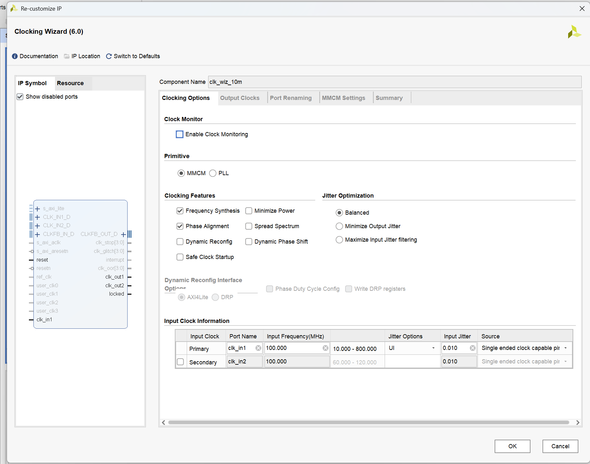

## T2-02 DDS怎样产生正弦波

**核心结论：** DDS不是一次存下一整条连续曲线，而是在每个采样时钟到来时推进相位，再根据当前相位查出一个正弦幅度。

可以把32位相位累加器看成一圈被分成 $2^{32}$ 份。每来一个10 MHz时钟上升沿，相位增加一次控制字 $K$：

$$
P[n+1]=(P[n]+K)\bmod 2^{32}
$$

其中：

- $P[n]$：第 $n$ 个采样时刻的相位码，无单位；
- $K$：32位频率控制字，无单位；
- $2^{32}$：相位转完一整圈对应的总码数；
- $f_s=10\ \text{MHz}$：DDS采样频率。

输出频率为：

$$
f_{out}=\frac{K}{2^{32}}f_s
$$

反过来，要产生目标频率时使用：

$$
K=\mathrm{round}\left(\frac{f_{out}2^{32}}{f_s}\right)
$$

例如1 kHz：

$$
K=\mathrm{round}\left(\frac{1000\times2^{32}}{10\,000\,000}\right)=429497
$$

最需要记住的工作过程是：

> 每来一个采样时钟上升沿，相位累加器就加一次 $K$；相邻两个上升沿之间的时间是采样周期；相位累计转完一圈所花的总时间，就是正弦波的一个周期。

**易错点：** $K$是每个采样周期前进的相位步长，不是直接把“1000”送进DDS。

**自述句：** DDS用控制字决定每次跨过多少相位，步长越大，相位绕一圈越快，输出频率越高。

## T2-03 频率分辨率和六个控制字

32位相位累加器的控制字最小只能改变1，因此理论频率分辨率为：

$$
\Delta f=\frac{f_s}{2^{32}}
=\frac{10\,000\,000}{4\,294\,967\,296}
\approx0.002328306\ \text{Hz}
$$

这里的0.002328306 Hz是**DDS理论控制分辨率**，不是示波器的测量分辨率，也不表示模拟输出在所有频率上都能达到同样的精度和质量。

| `freq_sel` | 物理开关组合 `{SW2,SW1,SW0}` | 目标频率 | 控制字K | K对应理论频率 |
|---|---|---:|---:|---:|
| `000` | 000 | 1 kHz | 429497 | 1000.000630 Hz |
| `001` | 001 | 10 kHz | 4294967 | 9999.999311 Hz |
| `010` | 010 | 50 kHz | 21474836 | 49999.998882 Hz |
| `011` | 011 | 1 MHz | 429496730 | 1000000.000931 Hz |
| `100` | 100 | 1.5 MHz | 644245094 | 1499999.999069 Hz |
| `101` | 101 | 2 MHz | 858993459 | 1999999.999534 Hz |

XDC对应关系为：

```text
freq_sel[0] → R1 → SW0
freq_sel[1] → N4 → SW1
freq_sel[2] → M4 → SW2
```

所以读三位选择码时按照 `{SW2,SW1,SW0}` 的顺序。`110`和`111`在DDS选择函数中仍回到默认1 kHz，但`111`在频率显示页面增加了一项信息显示功能：

```text
SW4=1、SW3=0、freq_sel=111
→ 数码管显示0.0023283 Hz
```

因为八位数码管只能容纳1位整数和7位小数，代码把精确值0.0023283064365 Hz近似显示为0.0023283 Hz。内部先保存放大$10^7$后的整数23283，BCD结果为`00023283`，再在最左位0之后点亮小数点。该选择只改变频率页面的显示内容，不会把DDS输出频率改成0.0023283 Hz；`111`时DDS仍输出默认1 kHz。

**对应代码：** `K_1KHZ`～`K_2MHZ`及 `select_frequency_word`。

**易错点：** `32'd429497`中的32表示位宽，`d`表示十进制；它不表示32乘以429497。

## T2-04 为什么开关要同步，`dds_config_valid`为什么只高一个周期

拨码开关相对10 MHz时钟是异步输入。设计先用两个寄存器同步：

```verilog
freq_sel_meta <= freq_sel;
freq_sel_sync <= freq_sel_meta;
```

`freq_sel_meta`是第一级采样，`freq_sel_sync`是第二级稳定值。这样降低亚稳态直接传播到DDS控制逻辑的风险。

配置过程为：

```verilog
dds_config_valid <= 1'b0;

if (!clk_10m_locked) begin
    dds_config_sent <= 1'b0;
end else if (!dds_config_sent ||
             (freq_sel_sync != freq_sel_last)) begin
    freq_sel_last    <= freq_sel_sync;
    dds_config_data  <= select_frequency_word(freq_sel_sync);
    dds_config_valid <= 1'b1;
    dds_config_sent  <= 1'b1;
end
```

每个10 MHz时钟沿先安排 `dds_config_valid`回到0。只有首次启动或检测到开关变化时，同一段时序逻辑才又把它安排为1，所以最终形成宽度为一个10 MHz周期的脉冲。该高电平在两个上升沿之间保持，DDS在下一个有效沿读取稳定的 `dds_config_data`。

`else if`属于前面的 `if`链：只有 `!clk_10m_locked`不成立时，才继续检查“尚未配置或开关改变”。`end`结束对应的 `begin`代码块；它不会单独形成新的判断条件。

**非阻塞赋值要点：** 当前时钟沿的条件判断读取旧值，所有 `<=`指定的新值在本次时钟沿处理完后一起生效。

**自述句：** 开关先经过两级同步；首次锁定或选择码变化时，控制逻辑把新K值和一个周期的valid脉冲送给DDS，其余时间valid保持0。

## T2-05 32位相位为什么可以输出16位正弦数据

**核心结论：** 32位相位和16位幅度描述的是两种不同物理量，不存在“用16位保存完整32位数据”的要求。

```text
32位相位累加器
    ↓ 取高位形成16位相位角地址
正弦查找/近似计算
    ↓
16位二进制补码幅度
```

- 32位相位宽度决定频率调节有多细；
- 16位相位角宽度决定查正弦函数时区分多少个相位位置；
- 16位输出宽度决定每个幅度样本的量化精度。

许多不同相位本来就会得到相同或非常接近的正弦幅度，例如 $\sin 30^\circ=\sin150^\circ$。因此相位到幅度不是一一对应的编码转换。

低16位相位虽然不直接进入相位角地址，但仍保留在32位累加器中不断累积，并在产生进位后改变高位。因此它们仍然决定长期平均频率的精细分辨率。

最终DDS配置为：10 MHz系统时钟、单通道、Standard模式、32位相位、16位相位角、16位正弦补码输出、可编程相位增量、自动延迟7周期。

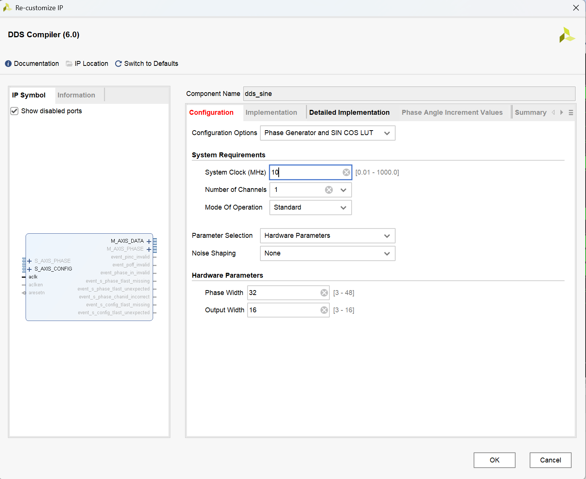

## T2-06 16位DDS样本怎样送到14位DAC

DDS输出 `dds_data`是16位二进制补码有符号数，而DAC接口需要14位偏移二进制。工程使用：

```verilog
dac_data_reg <= {~dds_data[15], dds_data[14:2]};
```

这一步包含两件事：

1. 丢弃最低2位，把16位幅度缩减为14位；
2. 翻转符号位，把二进制补码的零点转换到偏移二进制中点。

| DDS含义 | 16位补码示意 | 14位DAC含义 |
|---|---|---|
| 最大负值附近 | `1000...` | 接近0 |
| 零幅度 | `0000...` | `14'd8192` |
| 最大正值附近 | `0111...` | 接近16383 |

所以Testbench使用 `14'd8192`作为数字波形的零幅度中点，并寻找从小于8192到大于等于8192的上升过零点。

**易错点：** 数字码的满量程不等于示波器上的固定电压。实际电压还由DAC参考、I/V转换、放大/滤波网络、负载与探头设置决定。

## T2-07 ODDR为什么用于`dac_clk`

工程用FPGA专用输出双数据率单元转发DAC时钟：

```verilog
ODDR #(
    .DDR_CLK_EDGE("SAME_EDGE"),
    .INIT(1'b0),
    .SRTYPE("SYNC")
) u_dac_clk_oddr (
    .Q(dac_clk), .C(clk_10m), .CE(1'b1),
    .D1(1'b0), .D2(1'b1), .R(1'b0), .S(1'b0)
);
```

中文含义：

- `ODDR`：输出双数据率寄存器，可在时钟上升沿和下降沿更新输出；
- `DDR_CLK_EDGE="SAME_EDGE"`：D1、D2按同一上升沿关系装入；
- `INIT=0`：初始化输出为0；
- `SRTYPE="SYNC"`：置位/复位按时钟同步；
- `D1=0,D2=1`：使外部 `dac_clk`在内部10 MHz下降沿变高。

`dac_data_reg`在 `clk_10m`上升沿更新，而 `dac_clk`在50 ns后的下降沿上升。这样DAC采样时，数据已经稳定了半个时钟周期。

**工作过程：** `内部上升沿更新数据 → 等待50 ns → 外部dac_clk上升沿让DAC采样`

## T2-08 数字样本怎样成为模拟电压

```text
DDS数字幅度
→ 14位并行码
→ DAC电流输出
→ 模拟转换/放大网络
→ 板上输出支路与低通网络
→ SMA接口
→ 示波器
```

AD/DA板原理图显示，DAC后连接模拟转换与放大电路，并提供25 MHz和40 MHz的九阶LC低通支路。因此“没有另外串接一块外部低通滤波器”不等于整个模拟路径完全没有滤波；实际是否经过某一支路取决于所使用的SMA输出口。

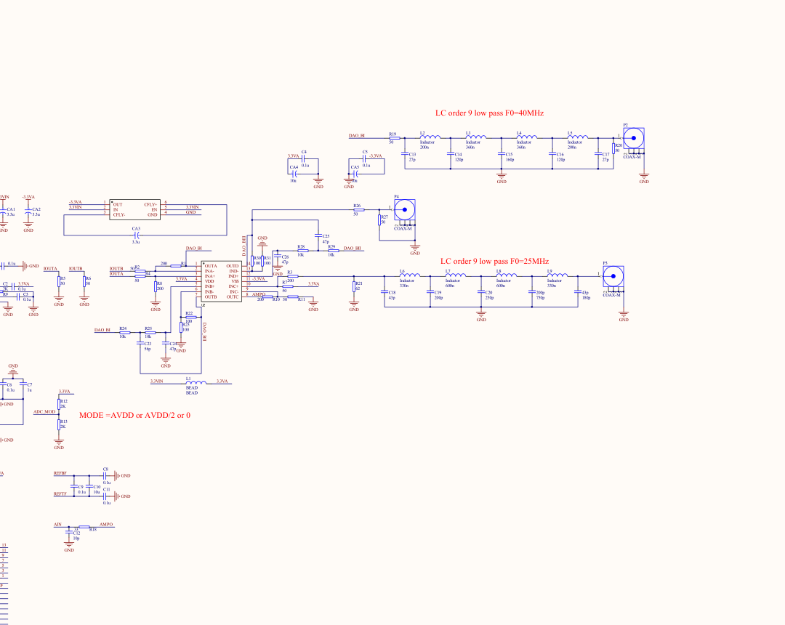

来源：`ADDA_Sch_PCB.pdf`第1页局部裁图。

低频时，每周期采样点很多；高频时采样点变少：

| 输出频率 | 每周期采样点数 $f_s/f_{out}$ |
|---:|---:|
| 1 kHz | 10000 |
| 10 kHz | 1000 |
| 50 kHz | 200 |
| 1 MHz | 10 |
| 1.5 MHz | 约6.67 |
| 2 MHz | 5 |

2 MHz数字样本每周期只有5点，直接观察DAC保持输出时容易看出阶梯。板上模拟网络、示波器带宽和显示插值会抑制高频镜像或让连线看起来更平滑，但不会增加DDS实际产生的数字采样点。

## T2-09 为什么不同频率的实测幅度不同

控制字 $K$只负责改变相位推进速度，也就是频率；工程没有为六个频点分别设置不同数字振幅。实测峰峰值仍会随频率变化，主要受下列因素影响：

```text
DDS数字满量程
× DAC满量程与参考
× 模拟转换/放大增益
× 输出低通网络频率响应
× 负载、终端与探头设置
= 示波器测得的电压幅度
```

本次归档的六张照片中，峰峰值约从低频的2.5～2.8 V降到2 MHz时的1.50 V。它反映了整条模拟输出链路的频率响应，不应写成DDS控制字改变了振幅。

## T2-10 Testbench验证了什么

归档文件：[tb_task2_dds.v](../../code/task2/tb_task2_dds.v)

Testbench实例化最终顶层 `id_display`，依次设置六个 `freq_sel`。每个频点进行两类检查：

1. 等待 `dds_config_valid`，核对内部 `dds_config_data`是否等于预期控制字；
2. 在 `dac_clk`上升沿采样 `dac_data`，检测上升过零点，跨多个周期求平均频率并检查误差是否不超过1%。

六个频点各产生两项检查，因此预期：

```text
PASS = 6 × 2 = 12
FAIL = 0
```

实际行为仿真控制台显示：

```text
Task 2 Testbench complete: PASS=12, FAIL=0
TASK 2 RESULT: PASS
```

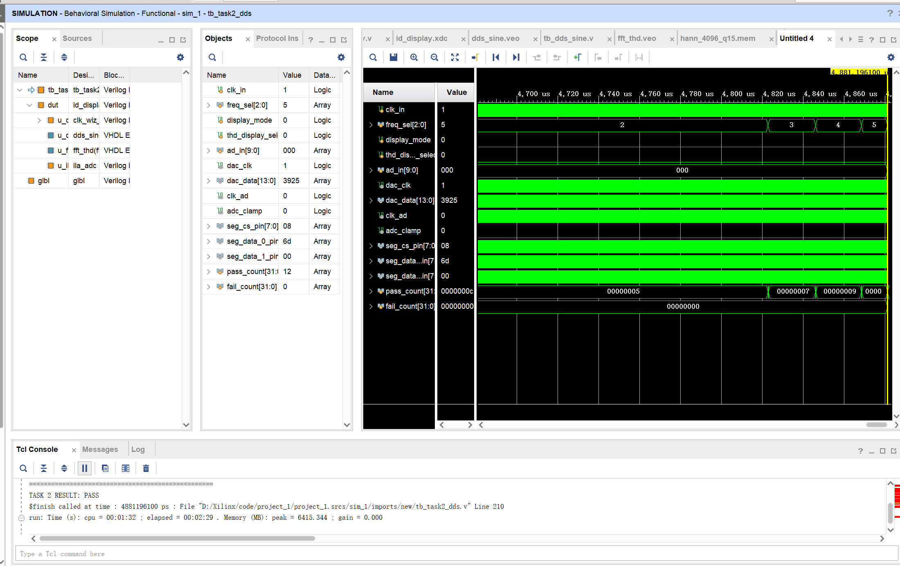

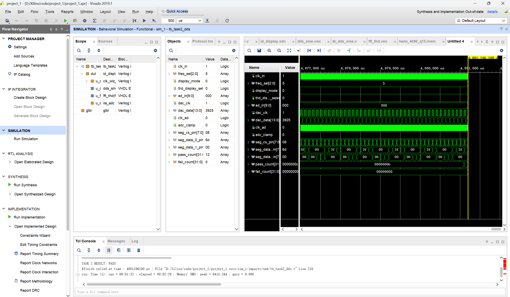

波形窗口中 `freq_sel=000`持续时间明显比 `101`长，是因为Testbench要等待若干个完整周期后才能测频。1 kHz的一个周期是1 ms，而2 MHz的一个周期只有0.5 μs。显示长度不同是测试等待时间不同，不表示开关失灵。

纯数字仿真能验证控制字、样本序列和数字频率，不能复现真实DAC电压、模拟滤波器幅频响应或示波器探头误差。

新增文件：[tb_task2_resolution_display.v](../../code/task2/tb_task2_resolution_display.v)专门检查`111`显示路径。它验证BCD为`00023283`、小数点位于最左侧数字之后，同时确认THD页面小数点、THD数据源和学号页面均未改变。Vivado Simulator 2019.1运行结果：

```text
Task 2 resolution-display test: PASS=8 FAIL=0
TASK 2 RESOLUTION DISPLAY RESULT: PASS
```

## T2-11 软件操作与硬件调试流程

```text
检查顶层与XDC
→ 配置Clock Wizard和DDS Compiler
→ Generate Output Products
→ 设tb_task2_dds为Simulation Top
→ Run Behavioral Simulation并确认12/0
→ Run Synthesis
→ Run Implementation
→ Generate Bitstream
→ Open Hardware Manager并连接器件
→ Program Device
→ 拨动SW2/SW1/SW0
→ 调整示波器时基、触发和垂直档位
→ 保存六组频率与峰峰值
```

切换频率时需要改变的是示波器时基：低频用较大的每格时间，高频用较小的每格时间，使屏幕上保留约3～10个周期。频率判断应同时看自动测量值和周期 $T$，并用 $f=1/T$交叉检查。

下载时曾出现 `.ltx File not found`。`.ltx`用于ILA调试探针映射；若本轮只下载已经生成的 `.bit`并观察外部波形，可以清除错误的Probe file路径后继续编程。该错误不等于 `.bit`文件生成失败。

## T2-12 六个频点的上板实测证据

硬件连接照片：

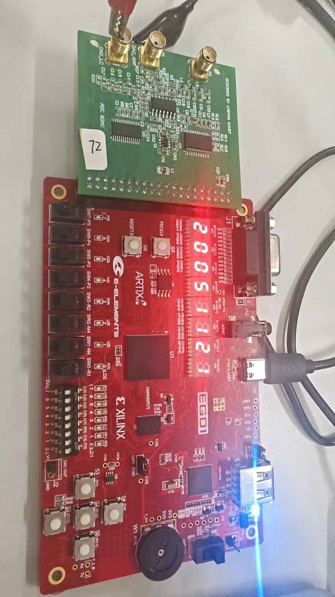

| 选择码 | 目标频率 | 示波器读数 | 周期读数 | 峰峰值 | 相对目标频率误差 |
|---|---:|---:|---:|---:|---:|
| `000` | 1 kHz | 999.0 Hz | 1.001 ms | 2.54 V | -0.100% |
| `001` | 10 kHz | 10.02 kHz | 99.75 μs | 2.66 V | +0.200% |
| `010` | 50 kHz | 49.73 kHz | 20.10 μs | 2.76 V | -0.540% |
| `011` | 1 MHz | 1.000 MHz | 1.000 μs | 2.44 V | 0.000%（按屏显有效位） |
| `100` | 1.5 MHz | 1.502 MHz | 666.0 ns | 2.16 V | +0.133% |
| `101` | 2 MHz | 2.000 MHz | 500.0 ns | 1.50 V | 0.000%（按屏显有效位） |

以上误差由照片上的示波器读数与目标值计算，受到屏显有效位、触发、采样、探头和模拟链路影响；不能把显示为0.000%的两项解释成绝对没有误差。

| 1 kHz | 10 kHz | 50 kHz |
|---|---|---|
| 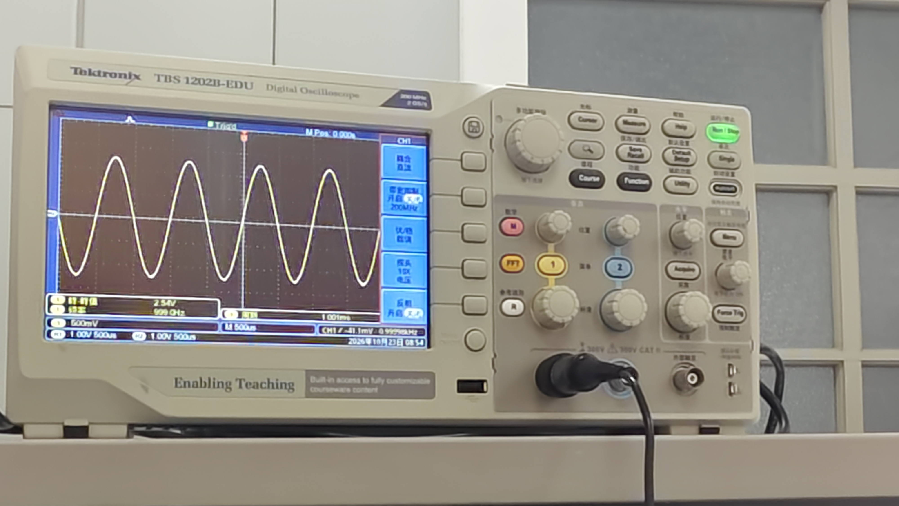 | 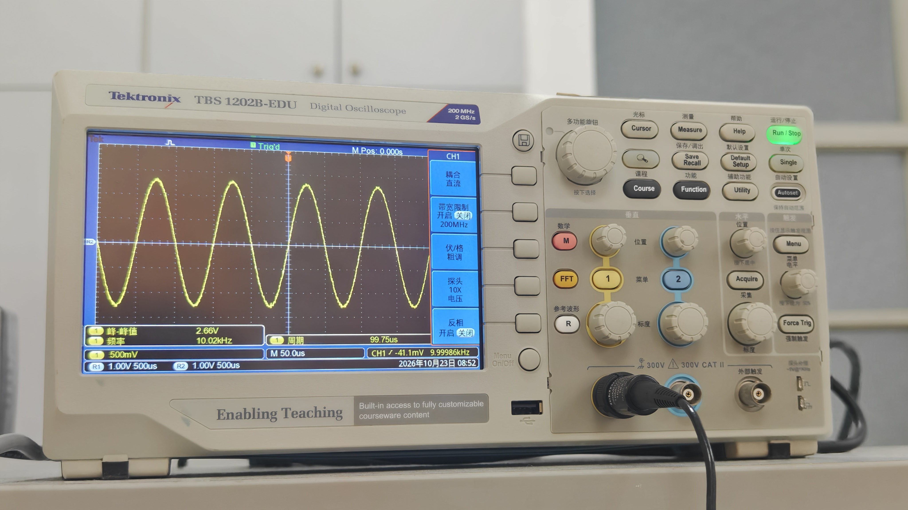 | 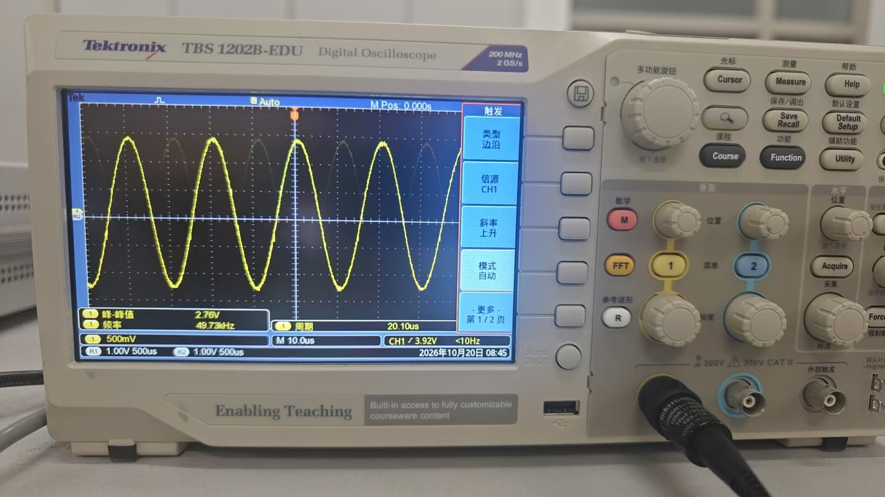 |

| 1 MHz | 1.5 MHz | 2 MHz |
|---|---|---|
| 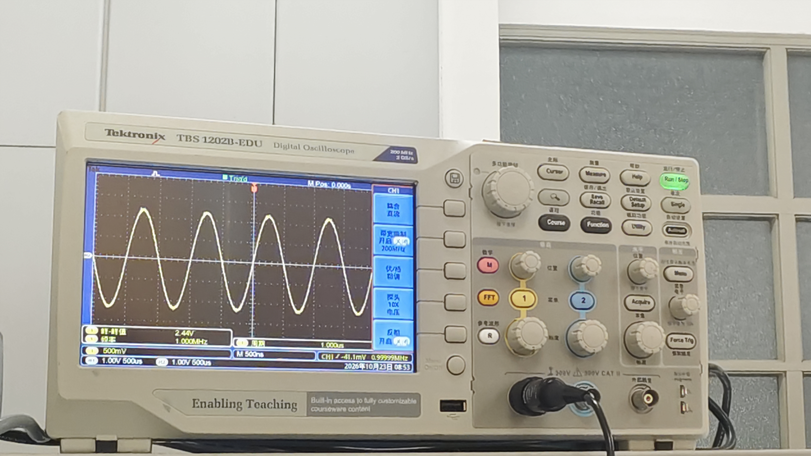 | 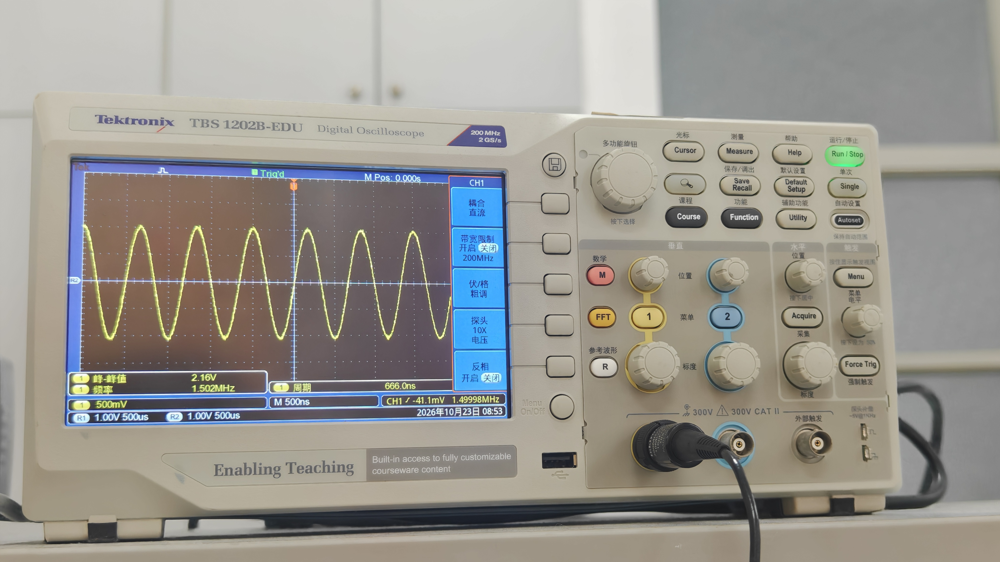 | 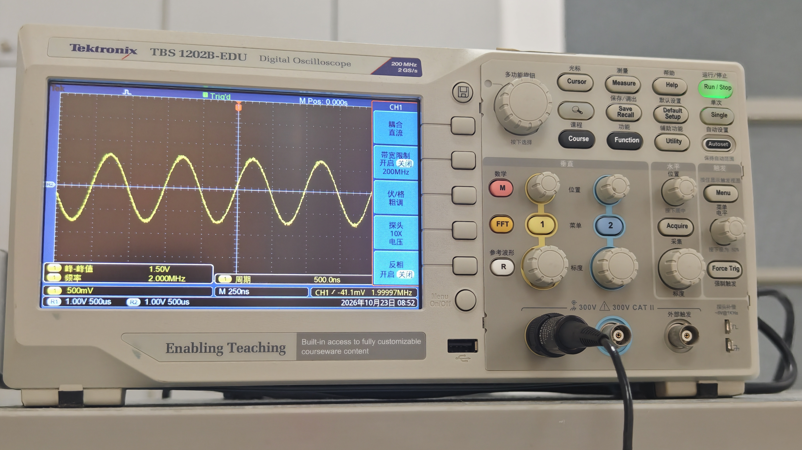 |

## T2-13 证据应该怎样表述

| 结论 | 依据 | 正确表述 |
|---|---|---|
| 控制分辨率0.002328306 Hz | 10 MHz、32位公式 | 理论计算 |
| 六个K值正确 | 最终代码与TB内部检查 | 代码参数+仿真结果 |
| 六种数字输出频率正确 | 过零测频Testbench | 行为仿真，12项通过 |
| 六种模拟输出频率接近目标 | 六张示波器照片 | 上板实测 |
| 高频幅度下降 | 示波器Vpp读数 | 实测现象，结合模拟链路分析 |
| 板上存在低通支路 | AD/DA板原理图 | 原理图事实 |
| 上板功能已经完成 | 用户说明+现有照片 | 已完成且已有材料支撑 |

## T2-14 本任务真实问题与解决方法

1. **DDS接口版本不一致：** 早期看到的模板只有固定输出接口，最终需要运行时切换频率。检查最终DDS wrapper和XCI后，采用带 `s_axis_config_tvalid/tdata`的可编程相位增量接口。
2. **开关编号容易按位序读反：** 最终依据XDC和板上丝印确认 `SW0=R1`、`SW1=N4`、`SW2=M4`，三位代码按 `{SW2,SW1,SW0}`读取。
3. **原有Testbench不能覆盖最终集成顶层：** 新建 `tb_task2_dds.v`，同时检查六个K值与六个输出频率，最终得到 `PASS=12、FAIL=0`。
4. **下载时Vivado寻找不存在的 `.ltx`：** 清除无效Probe file设置，继续使用已生成的bitstream完成下载；ILA文件缺失与外部DAC功能验证分开处理。
5. **2 MHz波形采样点较少：** 由10 MSPS/2 MHz可知每周期只有5点，数字波形出现明显离散性是正常现象；最终以正确模拟输出与示波器读数验证频率。

## T2-15 AI使用与更正

AI参与了代码阅读、DDS与时钟原理解释、Testbench编写、仿真波形解读、实测数据整理和报告归档。

本任务发生并已更正的内容：

1. **接口判断错误：** 曾依据不带配置端口的DDS模板讨论固定频率；检查最终工程后改为可编程 `S_AXIS_CONFIG`接口，并用最终Testbench验证。
2. **开关映射表述错误：** 曾把频率选择开关位置说错；用户指出后依据XDC更正为SW2-M4、SW1-N4、SW0-R1。
3. **滤波表述不完整：** 曾把“没有另接低通滤波器”理解为模拟链路完全无滤波；检查 `ADDA_Sch_PCB.pdf`后确认板上存在25 MHz和40 MHz九阶LC低通支路，现已按实际连接条件谨慎表述。

## T2-16 可直接复述的总结

> 本工程把100 MHz板载时钟经Clock Wizard变成10 MHz DDS采样时钟。三个拨码开关先同步到10 MHz时钟域，再选择一个32位频率控制字K。DDS每个采样时钟把相位累加器增加K，根据当前相位输出一个16位补码正弦幅度，因此输出频率为K乘10 MHz再除以二的32次方。16位样本经过截位和符号位翻转，转换成14位偏移二进制送入DAC。ODDR把采样时钟转发到外部，并让DAC采样沿比数据更新晚50 ns。六个频点的控制字和数字频率通过Testbench共12项自检，结果为12项通过、0项失败；上板后示波器也分别测得约1 kHz、10 kHz、50 kHz、1 MHz、1.5 MHz和2 MHz。把SW4置1、SW3置0并把三位频率开关拨到111时，数码管显示理论频率分辨率0.0023283 Hz；该选择只改变显示，DDS仍保持默认1 kHz输出。

## T2-17 当前进度与任务三衔接

```text
已掌握：
时钟变换 → 相位累加器 → 控制字计算 → 频率分辨率与111数码管显示
→ 开关同步 → 单周期配置脉冲 → DDS输出位宽
→ 补码到偏移二进制 → ODDR转发时钟 → DAC模拟输出
→ Testbench过零测频 → 示波器实测与误差分析

当前停止位置：
任务二已形成原理、代码、仿真、上板和材料归档闭环。

下一步：
任务三从AD/DA板ADC输入开始，学习如何把任务二的模拟正弦波采回FPGA、检测周期并把测得频率显示在数码管上。
```
