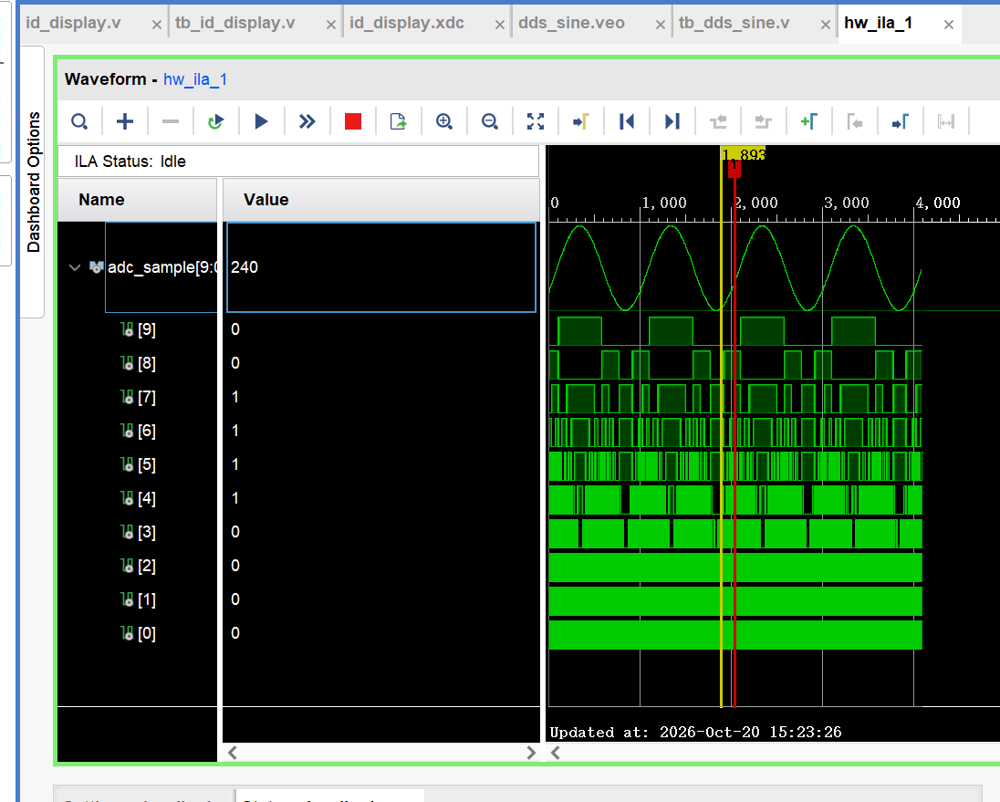
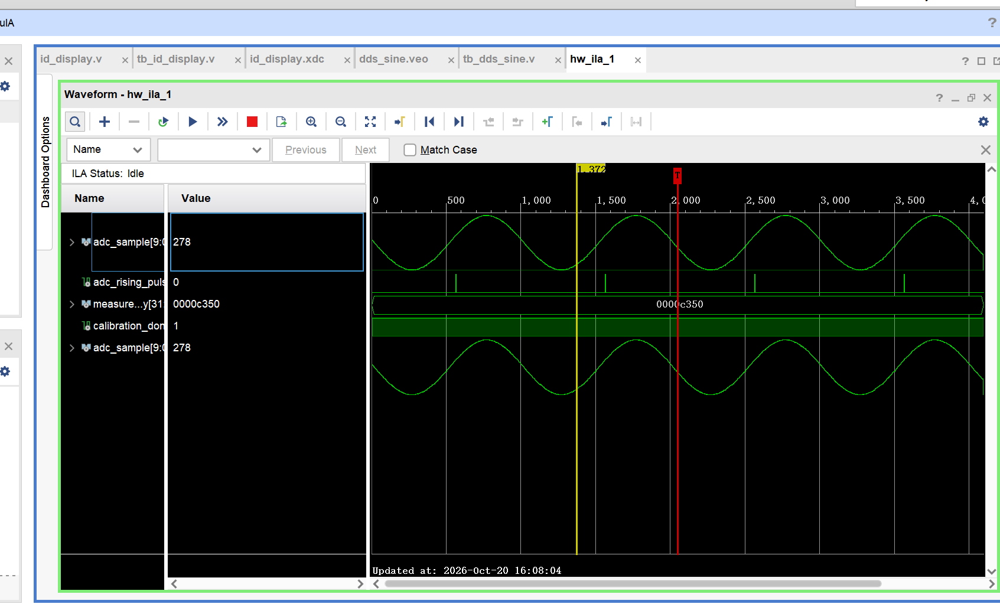
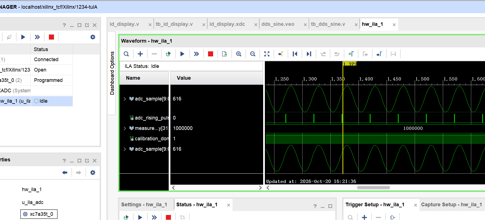
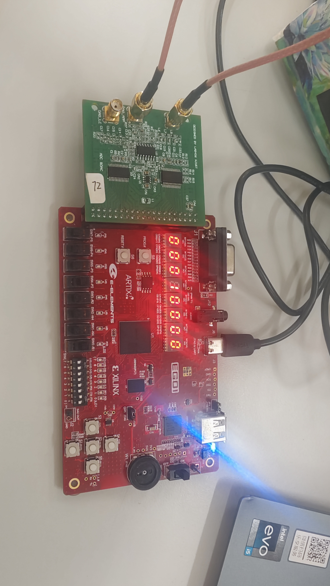
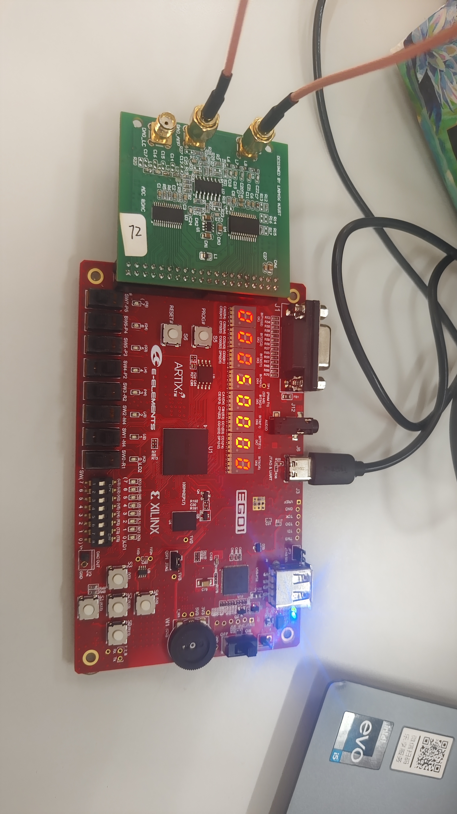
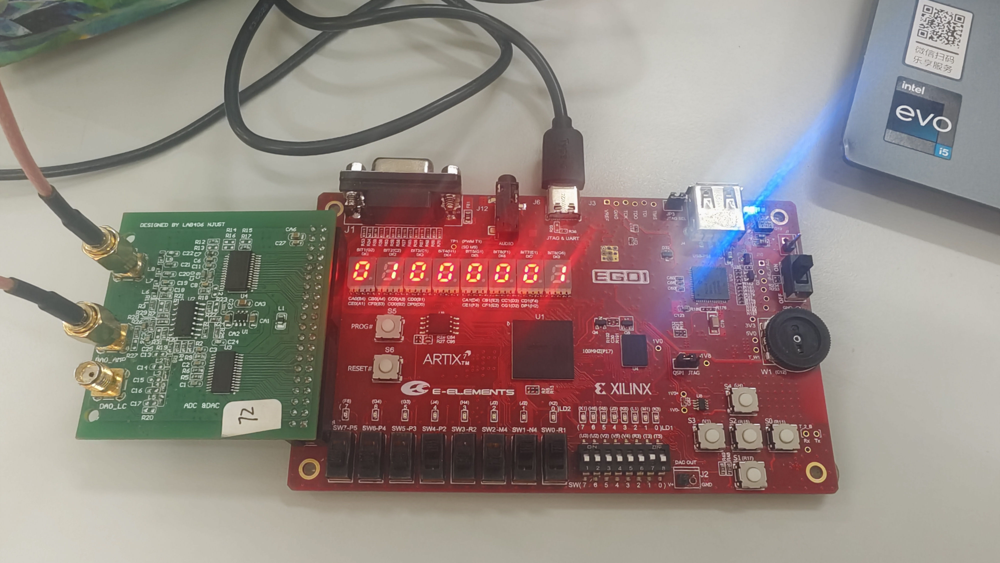
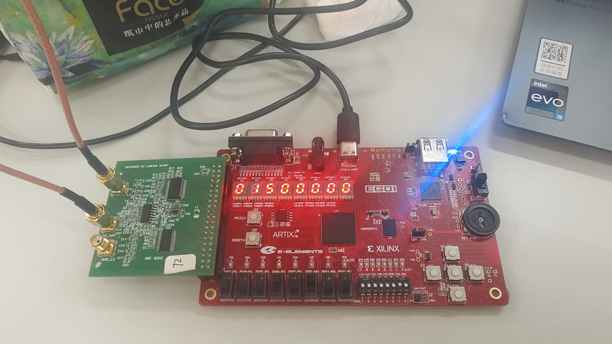
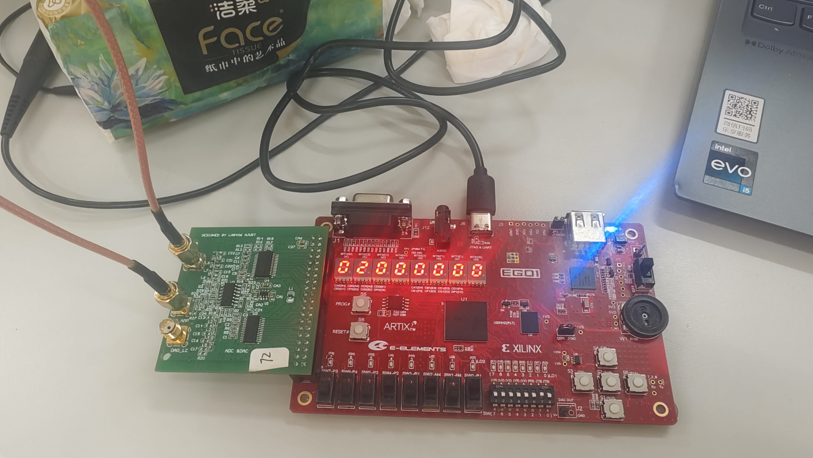

# 数字系统设计实验——任务三：正弦信号频率测量

> 学号：20051121<br>
> 姓名：待填写<br>
> 班级：待填写<br>
> 开发板：EGo1（Xilinx Artix-7，器件`xc7a35tcsg324-1`）<br>
> 外接板：14位DAC/10位ADC实验板<br>
> 开发工具：Vivado 2019.1<br>
> 工程状态：最终代码已完成；专用数字自检通过；ILA和数码管上板测频均已验证

## 1. 设计任务与系统位置

任务三要求对任务二产生的模拟正弦信号进行频率测量，并在八位数码管上显示测量结果。本设计没有直接读取任务二的DDS控制字，而是把DAC模拟输出通过SMA线回接至ADC，由FPGA处理真实ADC采样数据。因此，测量链路同时覆盖DDS、DAC、模拟输出、SMA连接、ADC和FPGA数字处理。

本任务在五项实验中的关系如下：

- 复用任务一的数码管动态扫描显示；
- 复用任务二的DDS、14位DAC、三个频率选择开关和10 MHz输出时钟；
- 新增50 MHz ADC接口、自动幅度校准、迟滞穿越检测、两秒门计数、结果跨时钟域和二进制转BCD；
- 为任务四、任务五提供已经验证的ADC采样、模拟回环与显示基础。

完整任务三RTL：[id_display_task3_complete.v](../../code/task3/id_display_task3_complete.v)

最终五任务集成RTL：[id_display.v](../../code/final/id_display.v)

## 2. 总体设计思路

```text
100 MHz板载时钟
    ├─→ 10 MHz：DDS与DAC
    ├─→ 50 MHz：ADC采样与测频
    └─→ 100 MHz：BCD转换与数码管扫描

freq_sel → DDS → 14位DAC → 模拟正弦输出
                              ↓ SMA回环
                         10位ADC采样
                              ↓
                 1 ms等待 + 10 ms校准
                              ↓
              高、低双门限迟滞上升穿越
                              ↓
                    2 s内统计周期数
                              ↓
                  measured_frequency
                              ↓
               更新翻转通知跨到100 MHz
                              ↓
                  二进制转八位BCD
                              ↓
                    数码管动态显示
```

设计采用直接计数法。正弦波每完成一个周期只产生一次有效上升穿越事件，在固定两秒内统计事件数并除以2即可得到以Hz为单位的频率。为了适应不同直流偏置和幅度，系统不使用固定中点，而是在每次切换频率后自动测量最小值和最大值，再生成高、低两个迟滞门限。

## 3. 核心原理

### 3.1 ADC采样

ADC采样率为50 MHz，采样周期为：

$$
T_{ADC}=\frac{1}{50\ \text{MHz}}=20\ \text{ns}
$$

10位ADC输出范围为0～1023。任务二14位DAC码先被转换成模拟电压，ADC再对电压进行10位量化。因此DAC与ADC位宽不相等不会阻止测频，但幅度量化细节会受10位ADC限制。

对于输入频率 $f_{in}$，每周期平均采样点数为：

$$
N_s=\frac{50\ \text{MHz}}{f_{in}}
$$

| 输入频率 | ADC每周期采样点数 |
|---:|---:|
| 10 kHz | 5000 |
| 50 kHz | 1000 |
| 1 MHz | 50 |
| 1.5 MHz | 约33.33 |
| 2 MHz | 25 |

### 3.2 自动门限与迟滞

频率切换后先等待1 ms，使模拟链路稳定；随后在10 ms内统计ADC最小值与最大值：

$$
R=ADC_{max}-ADC_{min}
$$

$$
M=\left\lfloor\frac{ADC_{max}+ADC_{min}}{2}\right\rfloor
$$

$$
H=\max\left(\left\lfloor\frac{R}{8}\right\rfloor,4\right)
$$

$$
ADC_{high}=M+H,\qquad ADC_{low}=M-H
$$

当 $R<32$ 个ADC码时，系统认为信号缺失或幅度过小并重新校准。`4`和`32`均以ADC码为单位，是本工程的抗噪参数。

迟滞检测逻辑为：低状态下只有达到高门限才产生上升事件；进入高状态后，必须回落到低门限才重新武装。这样避免噪声在单一阈值附近造成重复计数。

### 3.3 两秒测频

50 MHz时钟计满100,000,000个周期等于2秒。设两秒内检测到 $N$ 次上升穿越，则：

$$
f_{meas}=\frac{N}{2}
$$

理论计数分辨率为：

$$
\Delta f=\frac{1}{2\ \text{s}}=0.5\ \text{Hz}
$$

最终显示为整数Hz，因此0.5 Hz结果会整数取整。测频误差还可能来自板载时钟偏差、门边界、DDS实际频率、模拟链路噪声和高频幅度衰减。

### 3.4 跨时钟域与BCD显示

频率结果在50 MHz域每两秒更新一次，并在更新间隔内保持稳定。`measurement_update_toggle`每次完成测量后翻转，100 MHz域对数据和翻转通知分别做两级同步，然后检测翻转变化，启动32轮Double Dabble转换。

Double Dabble把32位二进制频率转换为八个4位BCD数字。每一轮先给所有大于或等于5的BCD组加3，再整体左移一位。32轮后得到可直接送给八位数码管的十进制数字。

## 4. 带注释的Verilog实现

完整带注释代码位于：[id_display_task3_complete.v](../../code/task3/id_display_task3_complete.v)

### 4.1 ADC时钟与输入采样

```verilog
ODDR #(
    .DDR_CLK_EDGE("SAME_EDGE"),
    .INIT(1'b0),
    .SRTYPE("SYNC")
) u_adc_clk_oddr (
    .Q(clk_ad), .C(clk_50m), .CE(clk_10m_locked),
    .D1(1'b1), .D2(1'b0), .R(1'b0), .S(1'b0)
);

always @(posedge clk_50m) begin
    if (!clk_10m_locked)
        adc_sample <= 10'd0;
    else
        adc_sample <= ad_in;
end
```

ODDR把内部50 MHz转发到外部ADC；FPGA在50 MHz上升沿把10位并行输入保存到`adc_sample`。

### 4.2 校准参数与门限计算

```verilog
localparam integer ADC_SETTLE_CYCLES      = 50_000;
localparam integer ADC_CALIBRATION_CYCLES = 500_000;
localparam integer FREQUENCY_GATE_CYCLES  = 100_000_000;

wire [9:0] adc_range_next =
    adc_maximum_next - adc_minimum_next;

wire [9:0] adc_midpoint_next =
    adc_sum_next[10:1];

wire [9:0] adc_hysteresis_raw =
    adc_range_next >> 3;

wire [9:0] adc_hysteresis_next =
    (adc_hysteresis_raw < 10'd4)
    ? 10'd4 : adc_hysteresis_raw;
```

`adc_minimum_next`和`adc_maximum_next`把校准最后一个采样点也包含在结果内，避免非阻塞赋值导致最后样本漏算。

### 4.3 迟滞上升穿越

```verilog
wire adc_rising_crossing_now =
    calibration_done &&
    !adc_signal_high &&
    (adc_sample >= adc_threshold_high);

if (adc_rising_crossing_now) begin
    adc_signal_high  <= 1'b1;
    adc_rising_pulse <= 1'b1;
end else if (adc_signal_high &&
             (adc_sample <= adc_threshold_low)) begin
    adc_signal_high <= 1'b0;
end
```

`adc_rising_pulse`宽度为一个50 MHz周期，即约20 ns。它是一次穿越事件标志，不表示正弦周期本身只有20 ns。

### 4.4 两秒门计数

```verilog
if (frequency_gate_count ==
    FREQUENCY_GATE_CYCLES - 1) begin

    measured_frequency <=
        (waveform_cycle_count +
         (adc_rising_crossing_now ? 32'd1 : 32'd0) +
         32'd1) >> 1;

    measurement_update_toggle <=
        ~measurement_update_toggle;
end
```

条件加1用于计入门结束时当前周期的穿越，固定加1用于除以2前的整数四舍五入。

### 4.5 二进制转BCD

```verilog
for (bcd_digit_index = 0;
     bcd_digit_index < 8;
     bcd_digit_index = bcd_digit_index + 1) begin

    if (bcd_shift[
            32 + bcd_digit_index * 4 +: 4
        ] >= 4'd5) begin

        bcd_adjusted[
            32 + bcd_digit_index * 4 +: 4
        ] = bcd_shift[
            32 + bcd_digit_index * 4 +: 4
        ] + 4'd3;
    end
end

assign bcd_shift_next = bcd_adjusted << 1;
```

左侧32位按八个BCD四位组使用，右侧32位存放原始二进制输入。每个满足条件的BCD组单独加3。

## 5. Testbench文件与数字仿真

专用文件：[tb_task3_frequency_measurement.v](../../code/task3/tb_task3_frequency_measurement.v)

该Testbench保持任务三RTL不变，通过行为模型替代Clock Wizard、DDS、ILA与ODDR IP。为避免每个用例真实等待2秒，它把已经验证的测量门计数器推进到最后一个周期，重点检查任务三新增数字逻辑：

1. 低于低门限不触发；
2. 第一次超过高门限产生一个脉冲；
3. 保持高电平不会重复触发；
4. 回落至低门限后重新武装；
5. 两秒门的99,999个已存事件经末周期处理和四舍五入得到50,000 Hz；
6. 二进制50,000转换为BCD `00050000`。

Vivado Simulator 2019.1运行结果：

```text
PASS: below low threshold produces no pulse
PASS: first high-threshold crossing produces one pulse
PASS: remaining above high threshold does not retrigger
PASS: falling below low threshold rearms detector
PASS: two-second gate result = 50000
PASS: binary 50000 converts to BCD 00050000 = 327680
Task 3 Testbench complete: PASS=6, FAIL=0
TASK 3 RESULT: PASS
```

完整日志：[task3_xsim_result.txt](../../assets/task3/task3_xsim_result.txt)

该仿真验证数字算法，不模拟真实DAC电压、ADC量化噪声和模拟线路；这些部分由ILA与上板照片支撑。

## 6. ILA内部验证

ADC样本总线设为Analog显示后，可以看到周期性的数字正弦曲线：



50 kHz测试中，ILA显示`calibration_done=1`，32位测量结果为十六进制`0000c350`，换算为十进制50,000：



1 MHz测试中，ILA显示`measured_frequency=1000000`，相邻穿越事件约间隔50个采样点，与 $50\text{ MHz}/1\text{ MHz}=50$ 一致：



ILA证据证明ADC码进入FPGA后形成周期波形，校准完成，穿越事件按周期出现，测频寄存器得到正确结果。

## 7. 上板实验结果与分析

### 7.1 测试连接

AD/DA板插在EGo1扩展接口上。一根SMA线把DAC模拟输出送入ADC模拟输入，另一根SMA线保留输出观测连接。照片能够看清外接板、SMA连接和八位数码管读数。

### 7.2 数码管结果

| 目标频率 | 数码管读数 | 绝对差值 | 相对目标值偏差 |
|---:|---:|---:|---:|
| 10,000 Hz | 10,000 Hz | 0 Hz | 0%（按显示整数） |
| 50,000 Hz | 50,000 Hz | 0 Hz | 0%（按显示整数） |
| 1,000,000 Hz | 1,000,001 Hz | +1 Hz | +0.0001% |
| 1,500,000 Hz | 1,500,000 Hz | 0 Hz | 0%（按显示整数） |
| 2,000,000 Hz | 2,000,000 Hz | 0 Hz | 0%（按显示整数） |

偏差计算式为：

$$
\varepsilon=\frac{f_{display}-f_{target}}{f_{target}}\times100\%
$$

这些差值以任务二的理论目标值为参考。当前照片没有同时拍到独立示波器频率，因此表中结果证明“任务二目标频率与任务三显示相符”，不能解释为已经用标准仪器完成频率准确度校准。显示为0也只表示整数显示值与目标相同。

| 10 kHz：`00010000` | 50 kHz：`00050000` |
|---|---|
|  |  |

| 1 MHz：`01000001` | 1.5 MHz：`01500000` | 2 MHz：`02000000` |
|---|---|---|
|  |  |  |

1 MHz显示值比目标多1 Hz。相对偏差仅为0.0001%，可能来自门边界、参考时钟和DDS实际输出；现有材料不足以单独归因于某一项。

### 7.3 尚待补存的证据

任务三已完成上板验证，但材料归档仍缺：

- 1 kHz数码管照片；建议同时拍清`00001000`、两根SMA线和AD/DA板；
- 同一测试条件下的示波器参考频率与数码管读数合照或数据表，用于独立计算测量精度。

## 8. 软件操作与硬件调试流程

1. 以最终`id_display`为顶层，核对ADC、DAC、数码管和开关端口与XDC一致。
2. 在Clock Wizard中保留10 MHz与50 MHz两个输出。
3. 配置ILA为5个探针，位宽依次为10、10、1、32、1。
4. Generate Output Products，重新运行Synthesis、Implementation和Generate Bitstream。
5. 用匹配的`.bit`与`.ltx`在Hardware Manager中Program Device。
6. 用SMA线连接DAC输出与ADC输入，选择任务二频率。
7. 等待约1 ms稳定、10 ms校准及2 s测量门完成。
8. 在ILA中观察ADC总线、穿越脉冲、`measured_frequency`和`calibration_done`。
9. 切换`display_mode`显示测得频率，并记录数码管结果。

## 9. 实际遇到的问题与解决方案

### 9.1 ILA探针数量与探针位宽混淆

配置时曾把`PROBE0 Width`误认为探针数量并改为5，导致顶层实例与ILA端口配置不匹配。正确设置是在General Options中把`Number of Probes`设为5，再分别配置10、10、1、32、1位。重新生成IP、综合、实现、bitstream并下载匹配`.ltx`后，五组信号可以正常显示。

### 9.2 ADC只显示一个固定数值

单个数值只能表示某一采样时刻的ADC码，不能证明波形变化。检查SMA回环后重新捕获，并将`adc_sample[9:0]`设为Analog显示，最终看到周期性数字正弦波。

### 9.3 最终集成版本信号名变化

任务三独立版使用`measured_frequency_meta/sync`，最终任务四、五集成版改为`frequency_display_value_meta/sync`。依据最终RTL核对后确认同步、通知和BCD流程仍然存在，属于命名调整。

## 10. AI使用记录与错误更正

AI用于最终工程代码阅读、ADC与门限原理解释、非阻塞赋值时序推演、Double Dabble演示、Testbench编写与运行、实拍数据读取、学习笔记和报告归档。

| 错误或不完整内容 | 发现依据 | 更正内容 | 验证情况 |
|---|---|---|---|
| 曾把BCD/显示逻辑说成10 MHz域 | 最终代码为`always @(posedge clk_in)` | 改为100 MHz显示域 | 与最终RTL一致 |
| 曾说50 MHz用于“恢复DAC模拟信号” | ADC接口与采样原理 | 改为50 MHz ADC采样和重新量化 | ILA看到10位采样波形 |
| 曾按任务三旧信号名查找集成版同步逻辑 | 最终集成RTL实际命名 | 改为`frequency_display_value_*`与`frequency_display_update_*` | 集成版代码已核对 |

## 11. 结论

本设计完成了任务二模拟正弦信号的ADC测频与八位数码管显示。50 MHz ADC每20 ns采集一个10位幅度码；系统在频率切换后自动统计最小值和最大值，生成中点及高、低迟滞门限。每个正弦周期只产生一次有效上升穿越，在2秒门时间内统计事件数并除以2，得到以Hz为单位的频率。测量结果通过更新翻转信号同步到100 MHz显示域，再转换为八位BCD进行动态扫描。

专用Testbench已在Vivado Simulator 2019.1中运行，六项数字检查全部通过。ILA已验证50 kHz与1 MHz内部测频结果；实拍照片显示10 kHz、50 kHz、1 MHz、1.5 MHz和2 MHz均能正确或近似正确显示。任务三已经形成代码、数字仿真、ILA和上板材料闭环；1 kHz照片和同条件示波器参考值仍待补存，不影响“上板功能已完成”的结论。

## 12. 任务四衔接摘要

- 已掌握：50 MHz ADC采样、10位量化、自动门限、迟滞穿越、两秒直接计数、CDC、BCD和数码管显示。
- 公共模块：Clock Wizard、DDS/DAC信号源、ADC接口、SMA回环、ILA与动态显示。
- 关键参数：ADC 50 MHz、10位；稳定等待1 ms；校准10 ms；门时间2 s；理论计数分辨率0.5 Hz。
- 已归档：任务三独立RTL、专用Testbench及6/0日志、3张ILA截图、5张数码管上板照片、学习日志与本报告。
- 待补材料：1 kHz数码管照片、同条件示波器参考频率。
- 下一任务：在同一ADC采样基础上分析频谱、基波与谐波能量并计算THD。
