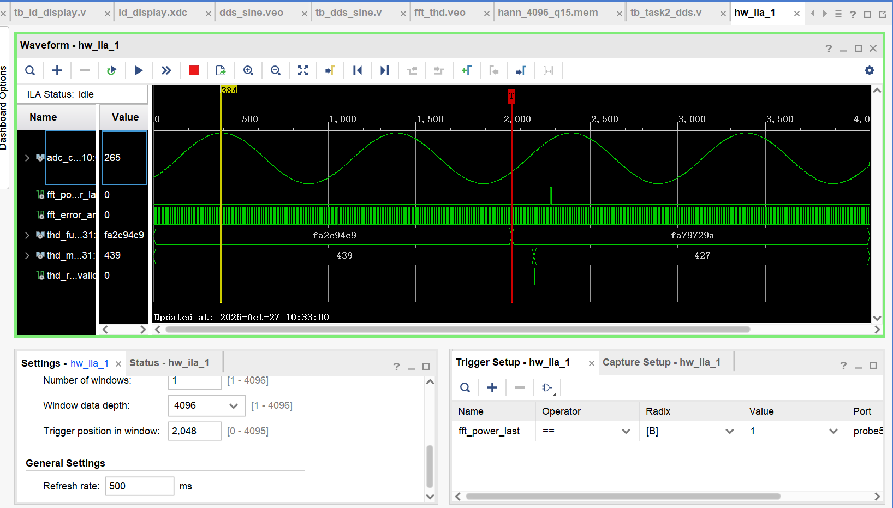
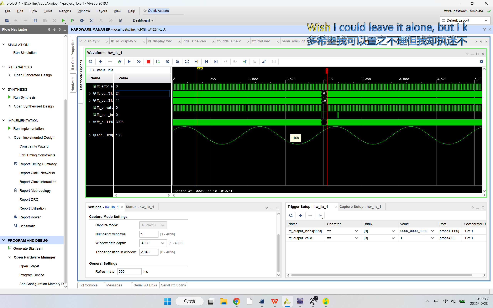
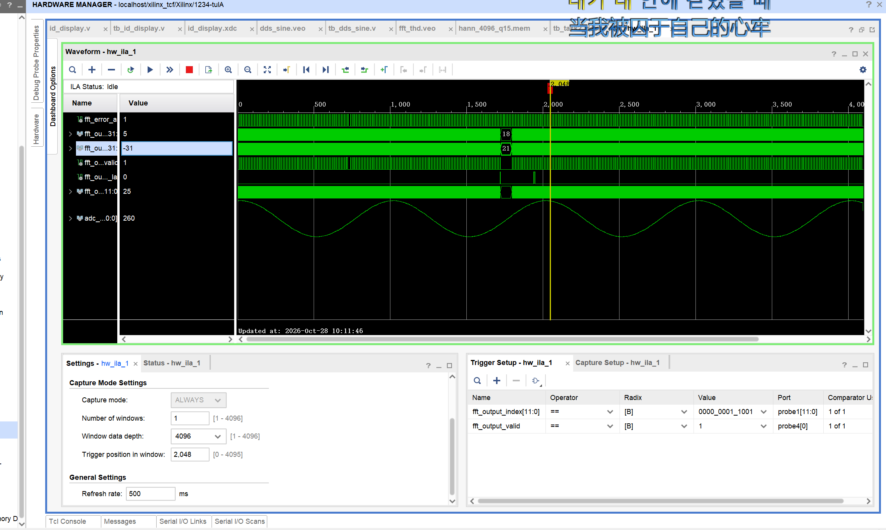
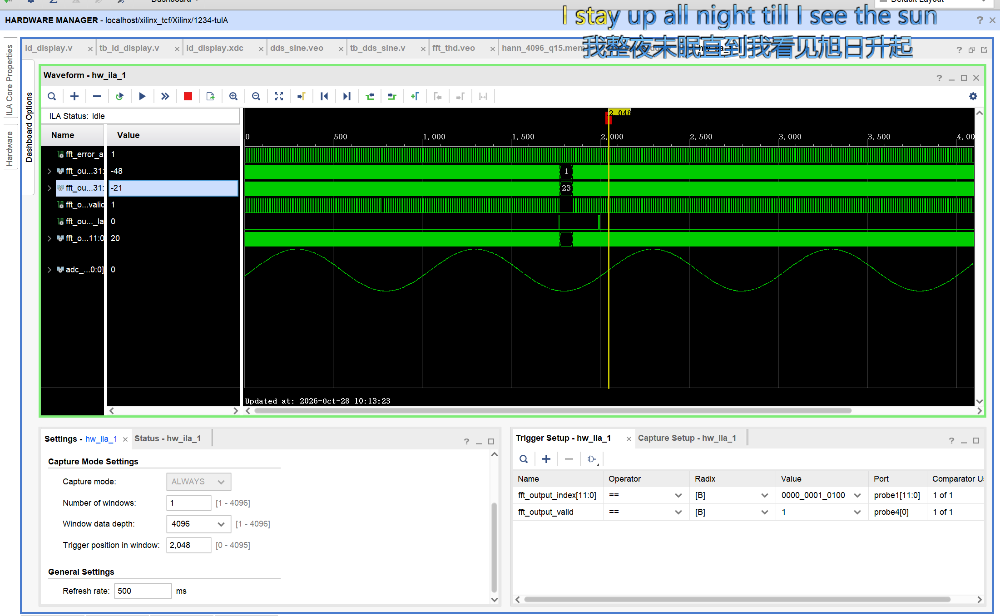

# 数字系统设计实验——任务四：固定频率正弦信号THD测量

> 学号：20051121<br>
> 姓名：待填写<br>
> 班级：待填写<br>
> 开发板：EGo1（Xilinx Artix-7，器件`xc7a35tcsg324-1`）<br>
> 外接板：14位DAC/10位ADC实验板<br>
> 开发工具：Vivado 2019.1<br>
> 工程状态：最终集成代码与Hann系数已归档；固定档位配置回归通过；已有代表性ILA波形；六档最终THD实测表和专用端到端Verilog Testbench尚待补存

## 1. 设计任务与验收边界

任务四要求把任务二产生的固定频率正弦信号经DAC输出，再通过ADC采样，在FPGA内计算总谐波失真THD，并在八位数码管上显示。固定频率共有六档：1 kHz、10 kHz、50 kHz、1 MHz、1.5 MHz和2 MHz。

本任务复用了：

- 任务一的八位数码管动态扫描；
- 任务二的DDS、DAC与`freq_sel[2:0]`频率选择；
- 任务三的50 MHz ADC采样、自动校准和频率测量；
- 新增平均抽取、4096点Hann窗、FFT、频带功率累计、定点除法/开平方和多帧平均。

固定正弦信号的理想THD为0%，但真实测量包含DDS量化、DAC非线性、模拟链路、ADC量化、时钟和噪声，因此没有一个脱离具体硬件的统一“合格理论值”。任务四应报告实际测量值、稳定范围和测试条件；若老师另给上限，则按该上限验收。

最终集成RTL：[id_display.v](../../code/final/id_display.v)

Hann系数：[hann_4096_q15.mem](../../code/final/hann_4096_q15.mem)

约束文件：[id_display.xdc](../../code/final/id_display.xdc)

## 2. 总体结构与信号流

```text
freq_sel[2:0]
    ↓
DDS → 14位DAC → 模拟正弦 → SMA回环 → 10位ADC，50 MSPS
                                              ↓
                                  自动校准并去除直流中点
                                              ↓
                               分组平均 + 按档位抽取
                                              ↓
                         4096点Hann窗 × 4096个有效样本
                                              ↓
                                      4096点FFT
                                              ↓
                         Re²+Im²，得到每个频点的功率
                                              ↓
                  基波频带功率P1 + 可观测谐波频带功率Ph
                                              ↓
                             THD = sqrt(Ph/P1) × 100%
                                              ↓
                                多帧平均与跨时钟域
                                              ↓
                              八位数码管显示百分数
```

FFT使用的不是“一个样本对应一个频率”。4096个抽取后的时间样本共同构成一帧，FFT把这一帧整体转换成4096个频点。第`k`个频点代表窗口内正好完成`k`个周期的复指数成分，其频率为：

$$
f_k=k\frac{F_{s,eff}}{4096}
$$

其中$F_{s,eff}$是抽取后的有效采样率。

## 3. 平均抽取与固定档位频点

本工程的“抽取5倍”不是简单丢掉前4个样本，而是先把连续5个ADC样本相加并近似求平均，再产生1个FFT有效样本。因此它同时完成低通平均与降采样。

| `freq_sel` | 正弦频率 | 平均/抽取倍数 | 有效采样率 | 精确基波位置 | 配置频点 |
|---|---:|---:|---:|---:|---:|
| `000` | 1 kHz | 500 | 100 kSPS | 40.960 | 41 |
| `001` | 10 kHz | 50 | 1 MSPS | 40.960 | 41 |
| `010` | 50 kHz | 10 | 5 MSPS | 40.960 | 41 |
| `011` | 1 MHz | 1 | 50 MSPS | 81.920 | 82 |
| `100` | 1.5 MHz | 1 | 50 MSPS | 122.880 | 123 |
| `101` | 2 MHz | 1 | 50 MSPS | 163.840 | 164 |

低频三档使用不同抽取倍数，使基波都落在约41号频点附近。这样既保持足够的低频分辨率，也避免为1 kHz信号等待过长的原始采样窗口。

例如50 kHz档：

$$
F_{s,eff}=\frac{50\ \text{MSPS}}{10}=5\ \text{MSPS}
$$

$$
\Delta f=\frac{5\ \text{MHz}}{4096}=1220.703125\ \text{Hz}
$$

$$
k_1=\frac{50\ \text{kHz}}{1220.703125\ \text{Hz}}=40.96\approx41
$$

## 4. Hann窗与FFT功率

第`n`个抽取样本与第`n`个Hann系数相乘：

$$
x_w[n]=x[n]w[n],\qquad 0\le n<4096
$$

Hann窗作用于整段时间波形。它不需要预先区分基波和谐波；输入波形中的全部频率成分都同时受到该窗函数作用。加窗减小了帧首尾不连续造成的频谱泄漏，但也把单一频率能量扩展到相邻频点，因此本设计累计中心附近的频带功率，而不是只读取一个频点。

FFT输出为复数：

$$
X[k]=Re[k]+jIm[k]
$$

每个频点的功率采用：

$$
P[k]=Re[k]^2+Im[k]^2
$$

代码中实部、虚部、输出序号、`valid`和`last`一起打一拍，避免非阻塞赋值导致“当前序号配到上一拍数据”的错位。

## 5. 基波与谐波频带选择

任务四已知每档基波频率，因此不需要自动搜索基波。基波和各次谐波均按中心频点±2累计，共5个频点，以覆盖Hann主瓣和小量频偏。

THD定义为：

$$
THD=\frac{\sqrt{V_2^2+V_3^2+\cdots}}{V_1}
   =\sqrt{\frac{P_2+P_3+\cdots}{P_1}}
$$

任务二DAC采样率为10 MHz，第一奈奎斯特区上限为5 MHz。高于5 MHz的分量会与DAC镜像和时钟馈通混叠，不能继续当作独立谐波，因此各档实际累计范围为：

| 基波档位 | 计入THD分子的谐波 |
|---:|---|
| 1 kHz、10 kHz、50 kHz | H2、H3、H4、H5 |
| 1 MHz | H2、H3、H4 |
| 1.5 MHz | H2、H3 |
| 2 MHz | H2 |

这意味着任务四的数值是当前硬件可观测带宽内的THD估计值。不同档位包含的最高谐波次数不同，比较六档数值时必须同时说明带宽条件。

## 6. 定点计算与稳定显示

硬件先求Q32功率比：

$$
R_{Q32}=\frac{P_h\times2^{32}}{P_1}
$$

再对Q32结果开平方，得到Q16幅度比，最后换算成`0.001%`单位：

```text
thd_millipercent = 439  →  0.439%
thd_millipercent = 48300 → 48.300%
```

除法采用96个时钟周期逐位迭代，平方根采用32个周期逐位迭代，避免综合出面积较大的组合除法器和开平方器。

单帧THD会随ADC噪声、频谱泄漏和帧起点变化而轻微波动。数码管显示的是`thd_display_millipercent`多帧平均值：低频档约1.7～2.6 s更新一次，高频档约2.7 s更新一次。ILA中的`thd_millipercent`是原始单帧值，变化比数码管快属于正常现象。

## 7. 关键Verilog实现

### 7.1 分组平均与抽取

```verilog
if (decimation_count == decimation_factor - 1'b1) begin
    decimation_sum   <= 21'sd0;
    decimation_count <= 10'd0;
    fft_input_data   <= {16'd0, windowed_adc_sample};
    fft_input_valid  <= 1'b1;
end else begin
    decimation_sum <= decimation_sum_next;
    decimation_count <= decimation_count + 10'd1;
end
```

每组样本只形成一个`fft_input_valid`，因此4096个FFT输入点跨越的真实时间随抽取倍数增加。

### 7.2 Hann窗

```verilog
initial begin
    $readmemh("hann_4096_q15.mem", hann_rom);
end

assign hann_coefficient = hann_rom[fft_input_index];
assign hann_product =
    decimated_adc_sample * $signed(hann_coefficient);
assign hann_product_scaled = hann_product >>> 15;
assign windowed_adc_sample = hann_product_scaled[15:0];
```

`fft_input_index`同时作为当前样本序号和窗ROM地址，保证第`n`个样本乘第`n`个窗系数。

### 7.3 频带功率累计

```verilog
assign thd_in_band_1 =
    thd_frequency_bins_valid &&
    (fft_power_index >= thd_bin_1 - thd_band_half_width) &&
    (fft_power_index <= thd_bin_1 + thd_band_half_width);
```

任务四中`thd_band_half_width=2`。命中基波或谐波频带时，将该频点的`Re²+Im²`累加到对应64位寄存器。

### 7.4 THD显示选择

开发板实际开关对应为：

| 开关 | XDC引脚 | 功能 |
|---|---|---|
| SW0、SW1、SW2 | R1、N4、M4 | `freq_sel[2:0]`，选择六个固定频率或任务五模式 |
| SW3 | R2 | `thd_display_select`，在频率和THD之间选择 |
| SW4 | P2 | `display_mode`，在学号和测量显示之间选择 |

显示任务四THD时应设置SW4=1、SW3=1，再用SW2～SW0选择`000`～`101`。数码管小数点固定在千分之一百分比格式，例如`0000.439`表示0.439%。

## 8. 回归检查与Testbench状态

固定档位检查脚本：[test_task4_configuration.py](../../code/task4/test_task4_configuration.py)

运行方法：

```text
python code/task4/test_task4_configuration.py \
  code/final/id_display.v code/final/hann_4096_q15.mem
```

该脚本重新计算六档有效采样率和基波频点，检查RTL中的抽取配置，并检查Hann文件有4096个、范围为0～32767的Q1.15系数。结果为：

```text
1 kHz、10 kHz、50 kHz → 40.960 → bin 41
1 MHz → 81.920 → bin 82
1.5 MHz → 122.880 → bin 123
2 MHz → 163.840 → bin 164
Hann coefficients: count=4096, min=0, max=32767
PASS: fixed profiles, Hann table and task-4 band logic are present
```

完整日志：[task4_configuration_regression_result.txt](../../assets/task4/task4_configuration_regression_result.txt)

该检查属于配置与算法回归，不是包含Xilinx FFT IP、ADC模型和完整顶层的端到端Verilog Testbench。仓库目前没有任务四专用RTL Testbench，因此不能写成“完整行为仿真通过”。最终报告若必须提供独立Testbench，应补建ADC正弦/谐波激励并在Vivado工程中联调FFT IP。

## 9. ILA与上板验证

一次固定档位捕获中，`adc_centered`显示稳定的数字正弦波，`thd_millipercent`在439和427之间更新，即原始单帧值约为0.439%和0.427%。该图证明ADC波形进入FPGA、FFT帧持续工作并产生THD结果；它只是一组代表性调试记录，不能替代六档最终数据表。



为了检查FFT原始输出，曾临时把ILA探针改成`fft_output_index`、实部、虚部、`valid`和`last`，并在指定输出序号触发：







红线是满足触发条件时在ILA存储缓冲区中的位置；黄线是用户移动的读数光标。`Trigger position in window=2048`只决定触发前后各保存多少拍，不会把20号频点放入“第20个窗口”。FFT频点序号应读取`fft_output_index`总线，ILA横轴是采样时钟记录序号。

最终归档RTL恢复为任务四、五结果探针。临时原始FFT探针配置属于调试手段，修改后需要重新综合、实现、生成bitstream，并使用匹配的`.ltx`。

## 10. 尚待补存的上板数据

应在同一连接、幅度和供电条件下记录：

| 固定频率 | 数码管稳定THD | ILA原始范围 | 仪器参考值 | 相对误差 |
|---:|---:|---:|---:|---:|
| 1 kHz | 待补 | 待补 | 待补 | 待算 |
| 10 kHz | 待补 | 待补 | 待补 | 待算 |
| 50 kHz | 待补 | 待补 | 待补 | 待算 |
| 1 MHz | 待补 | 待补 | 待补 | 待算 |
| 1.5 MHz | 待补 | 待补 | 待补 | 待算 |
| 2 MHz | 待补 | 待补 | 待补 | 待算 |

每档等待至少一次多帧平均完成后再拍摄。照片应同时包含开关位置、数码管、AD/DA板和连接线；若有示波器或失真度仪，应记录同一时刻参考读数。

## 11. 实际问题与解决方案

### 11.1 非相干采样导致能量泄漏

最初按单个频点取功率时，频率没有正好落在整数频点会导致基波和谐波能量分散。解决方法是给4096点时间样本乘Hann窗，并按中心±2的频带求和。

### 11.2 数码管读数变化太快

原始`thd_millipercent`每个FFT帧更新，2 MHz档会快速变化。解决方法是按各档帧时间选择2的整数次幂帧数求平均，数码管只显示平均结果。

### 11.3 高频档谐波次数不能照搬低频档

若2 MHz档仍累计H3～H5，这些频率已达到或超过DAC第一奈奎斯特区上限，可能把镜像和时钟馈通误当成谐波。最终代码按档位限制可观测谐波。

### 11.4 ILA横轴与FFT频点混淆

ILA横轴表示“第几个50 MHz采样时钟记录”，`fft_output_index`才表示FFT频点。通过在`fft_output_index==目标值`且`fft_output_valid==1`时触发，完成了两者的区分。

## 12. AI使用记录与错误更正

AI参与了FFT/频点原理解释、抽取方式纠错、Hann窗说明、ILA触发说明、代码核对、回归脚本和报告整理。

| 原建议或错误 | 如何发现 | 更正内容 | 验证依据 |
|---|---|---|---|
| 曾把抽取描述成“每5点只取第5点” | 与实际累加器代码不符 | 改为连续5点求和、近似平均后输出1点 | `decimation_sum`与`decimation_count`代码 |
| 曾把4096个样本理解成4096个独立频率输入 | FFT输入/输出含义推演 | 4096个时间样本共同生成4096个频点 | $f_k=kF_s/N$和ILA序号 |
| 曾把ILA红线、黄线与频点位置混淆 | 实际触发截图 | 红线是触发位置，黄线是读数光标，频点看`fft_output_index` | 指定20、25号频点触发记录 |
| 早期只取单点功率 | 非整数频点与Hann主瓣 | 改为中心附近频带累计 | 最终RTL的±2频带 |

## 13. 结论

任务四的最终集成代码已经完成六个固定频率档位的ADC采样、分组平均抽取、4096点Hann窗、FFT频谱、频带功率累计、定点THD计算、多帧稳定显示和ILA调试。配置回归确认六档基波频点与抽取参数一致，Hann文件完整；代表性ILA记录显示ADC正弦波和约0.43%的单帧THD结果。

目前可确认“设计链路和代表性上板功能已工作”。仓库尚缺六档最终稳定THD数据表、同条件仪器参考值和完整端到端Verilog Testbench，因此这些内容保留为待补材料，未写成已经验证通过。
